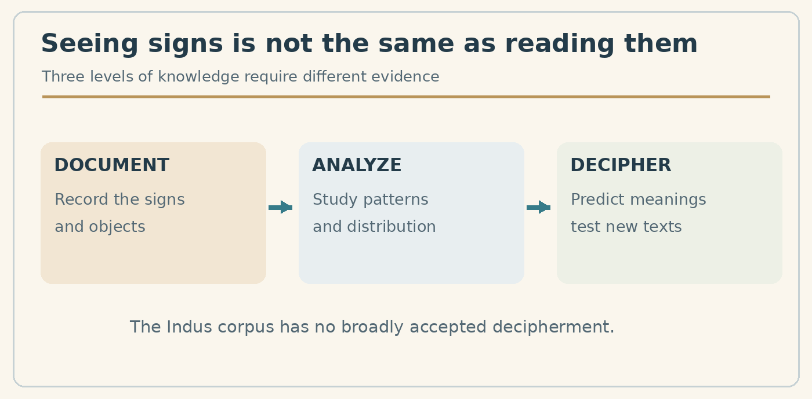

Знаците Indus се появяват върху печати, таблети, керамика и други предмети. Повечето надписи са кратки и не е открит широко приет двуезичен текст, еквивалентен на Розетския камък. Изследователите обсъждат не само как да се придадат звуци или значения на отделни знаци, но дали цялата система функционира като напълно развита система за писане на определен език или нещо по-ограничено, като сложна система за нелингвистични знаци. Много специалисти го смятат за сценарий, но предложените дешифриране и езикови задачи не са постигнали широко научно приемане. \[<a href="/013-the-indus-valley-civilization/sources/#source-3" class="cite">3</a>\]\[<a href="/013-the-indus-valley-civilization/sources/#source-4" class="cite">4</a>\]\[<a href="/013-the-indus-valley-civilization/sources/#source-15" class="cite">15</a>\]

Трябва да различим три нива на знание. Първо, самите белези съществуват: те могат да бъдат снимани, класифицирани и сравнявани. Второ, изследователите могат да анализират редовно как се появяват признаци и на кои видове обекти се появяват. Трето, предлагането на значението или звука на тези знаци изисква много по - силни доказателства. Поредица, повтаряща се в края на надписите може да бъде административен маркер, елемент име, граматически край или нещо друго. Статистическите модели помагат за стесняването на хипотезите, но определянето на модела не води до сигурно преведено изречение само по себе си.

<figure class="figure" id="figure-13-7">

<figcaption>Фигура 13.7. Три различни задачи: запис на знаци, изучаване на модели и производство на тестова дешифриране. <a class="figure-anchor" href="#figure-13-7" aria-label="Link to this figure">#</a></figcaption>
</figure>

Проблемът е необичайно устойчив, тъй като надписите обикновено са кратки, археологическите контексти варират, а основният език е несигурен. Учените са предложили различни езикови семейства и културни връзки, включително интерпретации, свързани с Дравидиан, но нито едно четене не е преминало комбинацията от независими тестове, широко покритие на надписите и научно споразумение, което прави древния египетски или клинописно дешифриране убедително. Бъдете особено подозрителни към онлайн твърдения, че цял корпус е "най-накрая решен" чрез намиране на няколко познати форми.

Нешифриран сценарий все още може да разкрие историята. Нейните знаци и разпространение показват повтарящи се визуални конвенции на разстояние. Тюлените и таблетките разкриват институции, имащи отношение към идентичността, сигнализирането или администрирането. Те също така ни казват нещо за границите на нашите доказателства: не трябва да пишем политическа или религиозна история, сякаш притежаваме изявления, които не можем да четем. Това е една от най-ясните демонстрации в Knowledge Kingdom на интелектуалното смирение като положително историческо умение.
