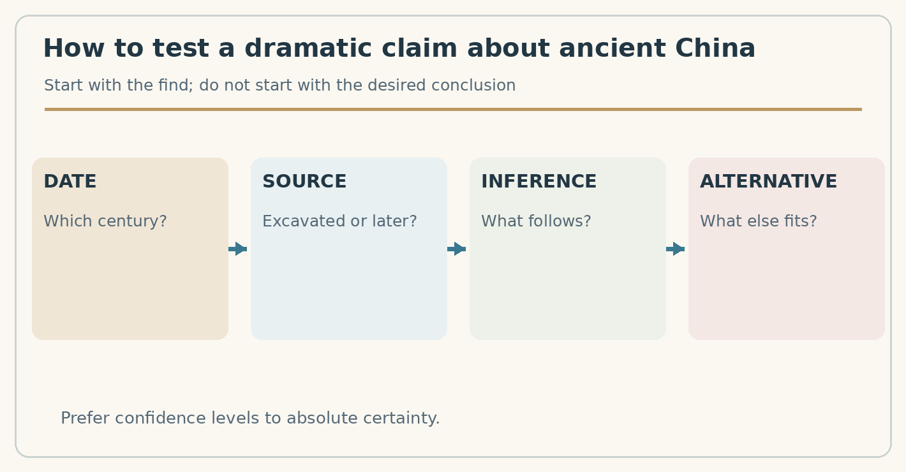

Използвайте този кратък метод, когато срещнете поразително твърдение за древна династия. Започнете с написването на иска в едно изречение с място и дата. Изброяване на действителните източници, разграничаване на екскавирани обекти от по-късните текстове. Идентифицирайте най-силните съвременни доказателства, ако има такива. Опиши поне една алтернативна интерпретация, а не просто алтернативна история. Попитайте се каква нова находка може да промени увереността си, като назовете владетел, запечатан слой от разкопки или по-голяма извадка от обикновени домакинства. След това посочете заключението си с калибриран език: демонстрира, поддържа, предполага или остава несигурно.

Един полезен последен тест е да се идентифицира къде съвременните политически идентичности са се промъкнали в древни описания. Съвременните карти са необходими, но територията на Китайската народна република в наши дни не е същата като кралството Шанг в края на второто хилядолетие пр.н.е. По подобен начин оцеляването на китайските герои чрез много исторически трансформации не е доказателство, че всеки по-късен политически режим наследява непроменена култура. Историческата приемственост става по-интересна, когато можем да обясним как е издържала въпреки промяната, не и когато се преструваме, че промяната никога не се е случвала.

<figure class="figure" id="figure-14-12">

<figcaption>Фигура 14.12. Твърдение за античността трябва да се тества спрямо датата, вида на източника и алтернативните тълкувания. <a class="figure-anchor" href="#figure-14-12" aria-label="Link to this figure">#</a></figcaption>
</figure>
