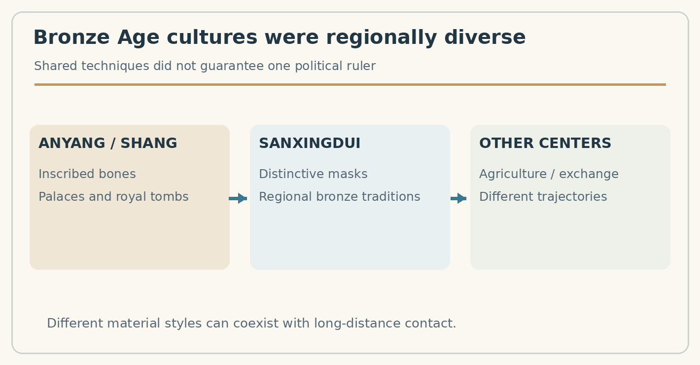

Ако разследването ни спре в Анянг, ранният Китай ще изглежда почти изцяло като история на Шанг. Откритията в Санксингдуи в днешната провинция Съчуан правят този подход неадекватен. Бронзови глави и маски, човешки фигури, нефрит и златни предмети разкриват изключителни художествени и церемониални традиции в регион, съвременен с Шанг. Някои форми не са като тези на централните равнини, макар че доказателствата също сочат към връзки чрез по-широки мрежи за обмен и знания. \[<a href="/014-ancient-china-dynasties-and-statecraft/sources/#source-5" class="cite">5</a>\]\[<a href="/014-ancient-china-dynasties-and-statecraft/sources/#source-17" class="cite">17</a>\]

Тези предмети не предоставят написана история на име Sanxingdui царе. Археолозите продължават да проучват залежите, производствените техники, датите и отношенията с други регионални центрове. Това е причина да избягваме фантазиите на изолирана "изгубена империя" или цивилизация, която не е свързана с никой друг. Различията и контактите могат да съществуват едновременно. Разнообразието от материални култури е точно това, което голям регион с много политически общности трябва да ни накарат да очакваме.

<figure class="figure" id="figure-14-7">

<figcaption>Фигура 14.7. Анян и Санксингдуи разкриват множество традиции от бронзовата епоха и взаимосвързана регионална история. <a class="figure-anchor" href="#figure-14-7" aria-label="Link to this figure">#</a></figcaption>
</figure>

Случаят Sanxingdui също показва как музеите влияят на историческото въображение. Една поразителна маска може да привлече много повече внимание от обикновените керамика, селскостопански инструменти или домакински останки. Ако изучаваме само грандиозните парчета, рискуваме да объркаме елитната ритуална изложба с пълния живот на едно общество. По-пълното реконструкция се нуждае от изкопни къщи, екологични доказателства, занаятчийски работилници, проучвания за препитание и регионални проучвания. Задачата на историка не е да избира между художественото чудо и трезвото разследване, а да използва всеки един от тях, за да освети другия.
