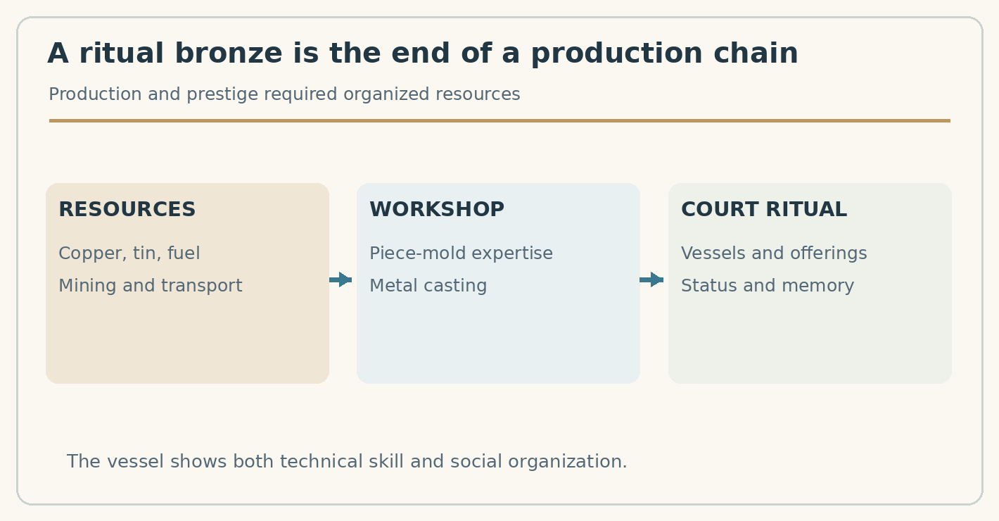

Бронзът обикновено е сплав от мед и калай, понякога съдържаща други метали. Световете Шанг и Джоу произвеждаха оръжия, инструменти и особено впечатляващи ритуални съдове. Създаване на голям декориран съд изисква метални източници, гориво, керамични плесени, специализирани умения за леене и координиран труд. По този начин един завършен кораб също беше видимо твърдение за достъп до мрежи от ресурси и хора. \[<a href="/014-ancient-china-dynasties-and-statecraft/sources/#source-11" class="cite">11</a>\]\[<a href="/014-ancient-china-dynasties-and-statecraft/sources/#source-14" class="cite">14</a>\]

Ранните китайски специалисти по бронзов кастинг разработиха много сложни методи за леене на парчета, в които декорирани глинени молдови секции и ядра позволиха сложни форми на съдове. Методът е отличителен по своята известност; подвеждащо е да се каже, че никоя друга цивилизация не е хвърляла бронз или че всички китайски бронзчета са били направени еднакво. Семинарите усъвършенстваха връзката между формата на съда, декоративната релефна и технологичната последователност на формоване и леене. \[<a href="/014-ancient-china-dynasties-and-statecraft/sources/#source-11" class="cite">11</a>\]

<figure class="figure" id="figure-14-5">

<figcaption>Фигура 14.5. Завършените бронзови съдове зависеха от ресурси, техники, социална организация и елитен патронаж. <a class="figure-anchor" href="#figure-14-5" aria-label="Link to this figure">#</a></figcaption>
</figure>

Да разгледаме един огромен кораб. Тя може да се използва в ритуални контексти, свързани с предлагане на храна и елитен статус. Един наблюдател може да се възхищава на своята художественост, но икономически историк задава допълнителни въпроси: кой копае мед, който транспортира руда, кой храни кастратите, кой решава формата и на кого е позволено да възложи предмета? Видимият бронз е изходът на невидимата социална система. Трябва също така да избягваме да допускаме, че всеки бронз е ясен показател за един-единствен ранг по всяко време; конвенциите и значенията се променят.
