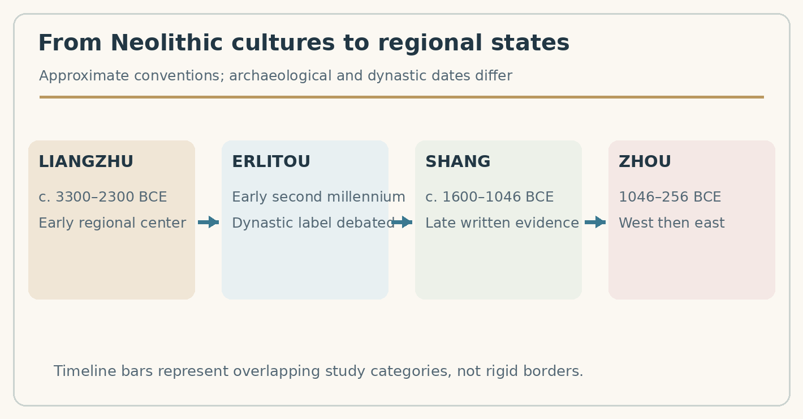

Учебник често представя три ранни управляващи къщи в последователност: Xia, Shang, Zhou. В традиционната китайска историческа писменост династията Ся предхожда Шанг. По-късно източници разказват истории за контрол на наводненията, образцови владетели и династична последователност. Това са важни културни спомени. Но те били написани много по-късно от периода, който описват, и историците не трябва да разглеждат традицията като доказателство, че всеки наречен владетел или дата може да бъде независимо проверен. \[<a href="/014-ancient-china-dynasties-and-statecraft/sources/#source-9" class="cite">9</a>\]\[<a href="/014-ancient-china-dynasties-and-statecraft/sources/#source-10" class="cite">10</a>\]

Археологията разкрива все по-сложни селища от Бронзовата епоха в средния район на Жълтата река. Мястото на Ерлиту, в днешния Хенан, често се обсъжда по отношение на традицията на Ся. Той разполага със значителни сгради, елитни материали и доказателства за производство на плавателни съдове; оценките обикновено поставят процъфтяването му в началото на второто хилядолетие BCE. Археологическо селище и по-късна текстова династия не са автоматично идентични. Няма общоприет съвременен надпис от Ерлиту, който убедително да назове владетелите си за царе на Ся. \[<a href="/014-ancient-china-dynasties-and-statecraft/sources/#source-9" class="cite">9</a>\]\[<a href="/014-ancient-china-dynasties-and-statecraft/sources/#source-10" class="cite">10</a>\]

За разлика от това Шанг може да бъде изучаван с рядка комбинация от разкопани места и съвременни кралски надписи от по-късната му фаза. Конвенционалните династични дати са около 1046 г. пр.н.е., но прецизността на ранните фази се обсъжда; най-ясният писмен прозорец идва от края на Шанг в Анянг, особено от около тринадесети век пр.н.е. Джоу победи Шанг около 1046 г. пр.н.е., според широко използван хронологичен конгрес. Периодът Western Zhou обикновено е с датирана 1046 по 771 г. пр.н.е., с периода на Източния Джоу, следван от около 770 г. пр.н.е. до края на кралската линия на Zhou през 256 г. пр.н.е. По-късно Чин обединение в 221 BCE принадлежи към следващата голяма трансформация, а не към безкраен "вечен Китай." \[<a href="/014-ancient-china-dynasties-and-statecraft/sources/#source-1" class="cite">1</a>\]\[<a href="/014-ancient-china-dynasties-and-statecraft/sources/#source-9" class="cite">9</a>\]\[<a href="/014-ancient-china-dynasties-and-statecraft/sources/#source-11" class="cite">11</a>\]

<figure class="figure" id="figure-14-3">

<figcaption>Фигура 14.3. Приблизителен хронологичен наръчник; археологически култури и по-късно династични етикети не са идентични категории. <a class="figure-anchor" href="#figure-14-3" aria-label="Link to this figure">#</a></figcaption>
</figure>

Не забравяйте какво правят тези етикети: те организират сложни доказателства. Династично име може да опише кралско потекло, културна мрежа, идеологически претенции и хронология на историците веднага. Границите и властта на управляващата къща рядко са били идентични през целия ѝ живот. Точната дата на битка може да бъде по-малко важна от разбирането кои видове доказателства определят последователността.
