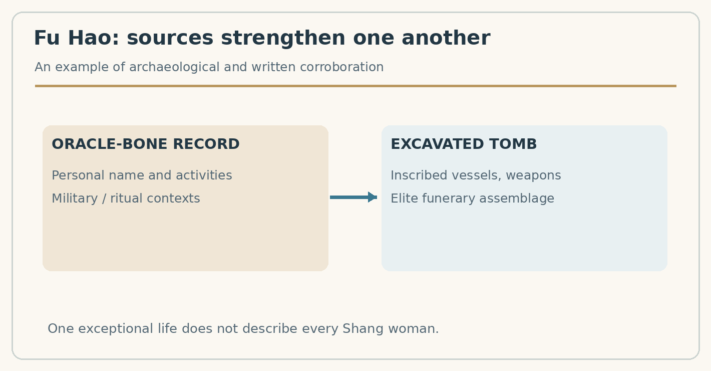

Една изключителна късна Шанг жена се появява в двете надписи и археология: Фу Хао, свързана с крал Ву Динг. Съобщенията на Оракула я свързват с военна дейност и ритуални отговорности, докато до голяма степен непокътната гробница, разкопана в Анян през 1976 г., съдържа богата бронзова обвивка, нефрит, оръжия, орнаменти и други предмети. Кръстосаната проверка между надписи и погребални улики е особено ценна. \[<a href="/014-ancient-china-dynasties-and-statecraft/sources/#source-15" class="cite">15</a>\]\[<a href="/014-ancient-china-dynasties-and-statecraft/sources/#source-16" class="cite">16</a>\]

Случаят на Фу Хао не оправдава заключението, че жените и мъжете са имали равни правомощия в обществото Шанг. Тя установява нещо по-точно и по-информационно: поне една известна кралска жена заемаше големи политически, военни и церемониални роли, а някои елитни жени можеха да командват значителни ресурси. Други жени са живели много различен живот, повечето от които са по-трудни за възстановяване от оцелели източници. Трябва да устоим и на двете крайности: представяйки си едно напълно безпомощно женско население и представяйки си равно общество върху силата на една известна гробница.

<figure class="figure" id="figure-14-6">

<figcaption>Фигура 14.6. Гробницата на Фу Хао и писмените записи осигуряват допълнително, но не и доказателство за ролите на жените. <a class="figure-anchor" href="#figure-14-6" aria-label="Link to this figure">#</a></figcaption>
</figure>

Гробницата също е урок по доказателства. Оръжията могат да подкрепят тълкуването на военното положение; надписите дават особен контекст; свързаните с тях гробни стоки показват елитен достъп до занаяти и обмен. Въпреки това отлаганията в гробницата отразяват забавния избор, както и дейностите, извършвани в живота. Най-безопасният извод съчетава различни видове доказателства и избягва третирането на всеки обект като точния еквивалент на съвременна автобиография. Откриването на гробницата на Фу Хао показва как един добре документиран сайт може да предизвика опростен разказ.
