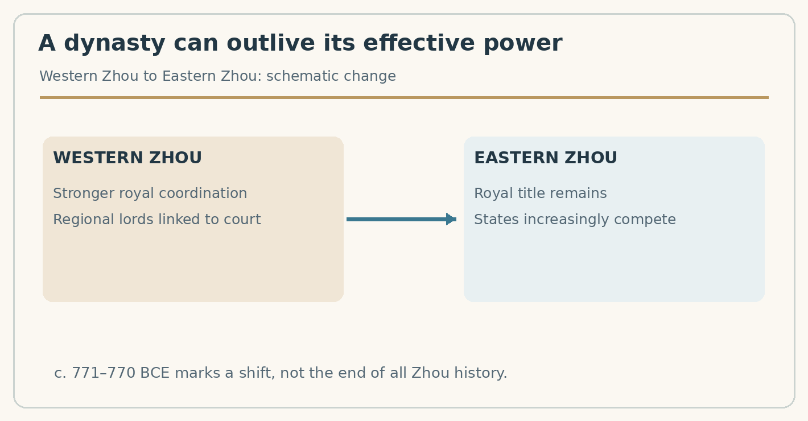

От покойния Западен Джоу балансът между кралската власт и регионалните сили се е обтегнал. Сметките за конфликт и натиск от съседни групи обграждат кризата, която сложи край на управлението на Западен Джоу през 771 г. пр.н.е. Съдът се премести на изток, а периодът, който обикновено започва около 770 г. пр.н.е., е известен като Източния Джоу. Историците трябва да бъдат предпазливи относно третирането на всеки драматичен епизод в по-късните разкази като точно документирана причина. Дългосрочната ерозия на ефективния кралски контрол е по-важна от всеки един колоритен анекдот. \[<a href="/014-ancient-china-dynasties-and-statecraft/sources/#source-11" class="cite">11</a>\]\[<a href="/014-ancient-china-dynasties-and-statecraft/sources/#source-18" class="cite">18</a>\]

При източния Джоу кралят на Жоу запази символично значение, докато много регионални държави упражняваха все по-независима власт. Конкуренцията между съдилищата насърчава военни и административни иновации. Съюзите се изместиха, съперниците търсеха предимство и институциите се адаптираха. Някои от тези събития приличат на теми, които познаваме от други истории: конкуренцията между Месопотамските градове-държави или баланса между центъра на империята и граничните лидери. Но подробните институции бяха различни и трябва да сравним механизмите, а не да приемаме идентични истории.

<figure class="figure" id="figure-14-10">

<figcaption>Фигура 14.10. Кралската титла може да надживее практическата власт, тъй като държавите се конкурират и политическите институции се променят. <a class="figure-anchor" href="#figure-14-10" aria-label="Link to this figure">#</a></figcaption>
</figure>

Източният Джоу често е разделен на пролетните и есенните и воюващите периоди. Периодните граници варират донякъде между ученическите конгреси; ерата на воюващите държави често е датираща от V век пр.н.е. до обединението на Цин в 221 г. пр.н.е. Това по-късно състезание ще бъде централно, когато се върнем в древен Китай в следващите глави. Тук целта е да се види как династия може да оцелее като титла, докато голяма част от нейната практическа власт се разпръсва. Разликата между официалната легитимност и ефективната власт е един от най-трайните уроци в световната история.
