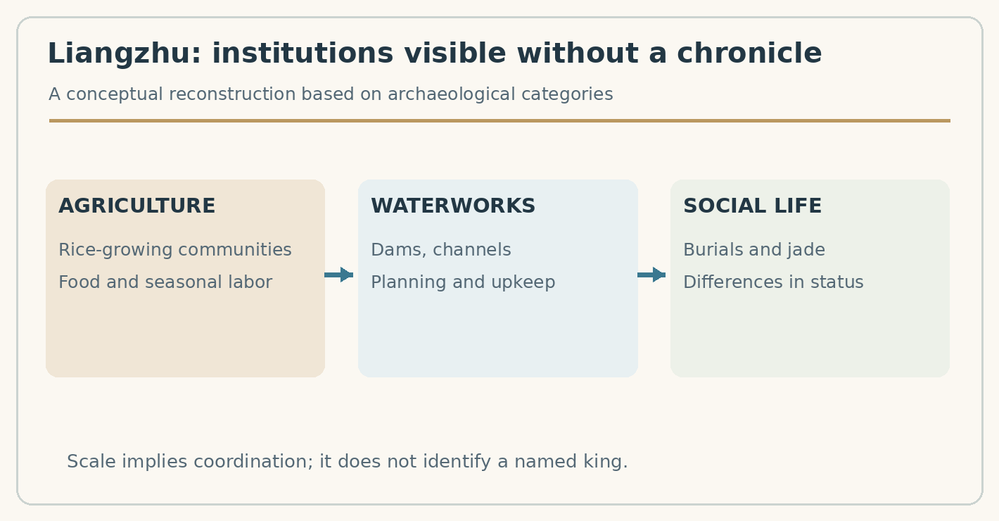

В долната част на Янгдзъ културата Лиангджу процъфтявала приблизително 3300.2300 BCE. Около своя основен център археолозите са документирали значителни земни работи, структури за управление на водата, сложни нефритени предмети и гробища, чиито различия предполагат социална класация. Обширната водоемна система и планирането на селището изискваха координация на труда, материалите и инженерните познания. ЮНЕСКО признава археологическите руини като доказателство за ранен регионален политически център, основан на оризовото земеделие. \[<a href="/014-ancient-china-dynasties-and-statecraft/sources/#source-7" class="cite">7</a>\]\[<a href="/014-ancient-china-dynasties-and-statecraft/sources/#source-8" class="cite">8</a>\]

Думата "държава" тук е обосновано археологическо тълкуване, а не запис на древна конституция. Не можем да четем кралска хроника на Лянджу, която нарича владетели и министри. Вместо това ние въвеждаме институционална сложност от строителния мащаб, променяйки селищата, погребенията и повтарящите се символи. Претенциите на "унифицирана система за вярване" описват модели в материалното досие, а не пълно богословско ръководство. Изкушението да се етикетира всеки сложен нефритен обект като значка на конкретен модерен офис трябва да се устои. \[<a href="/014-ancient-china-dynasties-and-statecraft/sources/#source-7" class="cite">7</a>\]\[<a href="/014-ancient-china-dynasties-and-statecraft/sources/#source-8" class="cite">8</a>\]

Представи си какво е необходимо за координацията на язовирите. Храната трябва да поддържа работниците, специалистите трябва да разберат къде тече водата и работниците трябва да се съберат на правилното място в правилния сезон. Някой може да наложи решение; други трябва да си сътрудничат, преговарят или приемат задължения. Това показва стойността на мисленето на системите на глава 7: дори и без четливи правни текстове инфраструктурата разкрива взаимозависимост. Това не доказва автоматично същата политическа структура по-късно, свързана с Shang или Zhou.

<figure class="figure" id="figure-14-2">

<figcaption>Фигура 14.2. Водните системи, земеделието и диференцираните погребения предоставят доказателства за колективна организация в Лянджу. <a class="figure-anchor" href="#figure-14-2" aria-label="Link to this figure">#</a></figcaption>
</figure>

Историята Лиангджу има значение, защото предотвратява мит за произход само от Жълто-Ривър. Възходът на сложното общество в древна Източна Азия е бил регионален и множествен. Различните центрове нарастваха, адаптираха се и понякога намаляваха. Някои културни и технически традиции навлизат в по-късните общества; други следват различни истории. Записът е за експерименти, контакти и прекъсване, както и приемственост.
