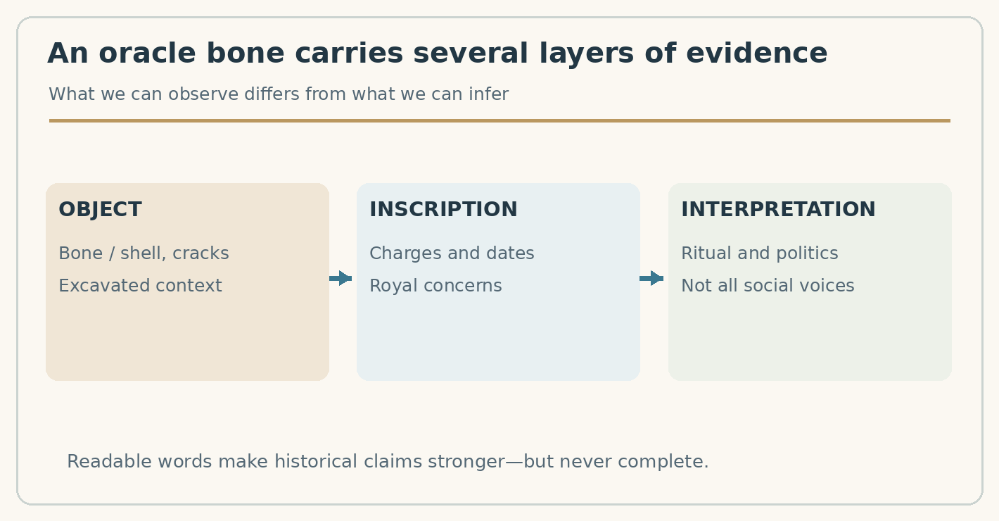

Оракул-костен надпис често принадлежи към процедура, понякога наречена пироостеоманс: приготвен животински кост или костенурка пластрон е бил нагряван, така че пукнатини се появяват и са тълкувани. Надписът може да запише предложението или обвинението, които са провели гадателството, а в някои случаи - предсказание или последваща проверка. Не всяка кост носи една и съща цялостна формула. Формулярите се променят през късния период на Шанг и не всяка марка е изречение, което учените могат уверено да преведат. \[<a href="/014-ancient-china-dynasties-and-statecraft/sources/#source-2" class="cite">2</a>\]\[<a href="/014-ancient-china-dynasties-and-statecraft/sources/#source-3" class="cite">3</a>\]\[<a href="/014-ancient-china-dynasties-and-statecraft/sources/#source-12" class="cite">12</a>\]

Въпросите често се отнасят до онова, което владетелите трябва да знаят или влияят: дъжд, жътва, военни кампании, болести, лов, раждане и приноси. Съвременните читатели могат да отделят религията от администрацията, но съдът Шанг не действа с нашето съвременно разграничение. Разделянето принадлежеше на решения с икономически и военни последици, точно както предшествениците са принадлежали към твърдения за легитимност. Надписите предлагат информация за календрични системи, лични имена, ритуални графици и политически притеснения. \[<a href="/014-ancient-china-dynasties-and-statecraft/sources/#source-2" class="cite">2</a>\]

<figure class="figure" id="figure-14-4">

<figcaption>Фигура 14.4. Материална находка се превръща в доказателство за съдебна практика чрез надписи, контексти и внимателно тълкуване. <a class="figure-anchor" href="#figure-14-4" aria-label="Link to this figure">#</a></figcaption>
</figure>

Извънредната приемственост на китайската писменост трябва да бъде описана точно. Късно Shang надписи са сред най-ранните обширни, сигурно признати доказателства за китайски писане, но това не показва, че всеки модерен характер може да бъде проследен до една конкретна кост или че говоримият език е идентичен на съвременния мандарин. Писането се променя чрез бронзови надписи, регионални сценарии, по-късно стандартизиране и много следващи векове. Нито пък мистериозните следи по много по-ранна керамика автоматично доказват пълен, дешифриран писмен език. \[<a href="/014-ancient-china-dynasties-and-statecraft/sources/#source-3" class="cite">3</a>\]\[<a href="/014-ancient-china-dynasties-and-statecraft/sources/#source-13" class="cite">13</a>\]
