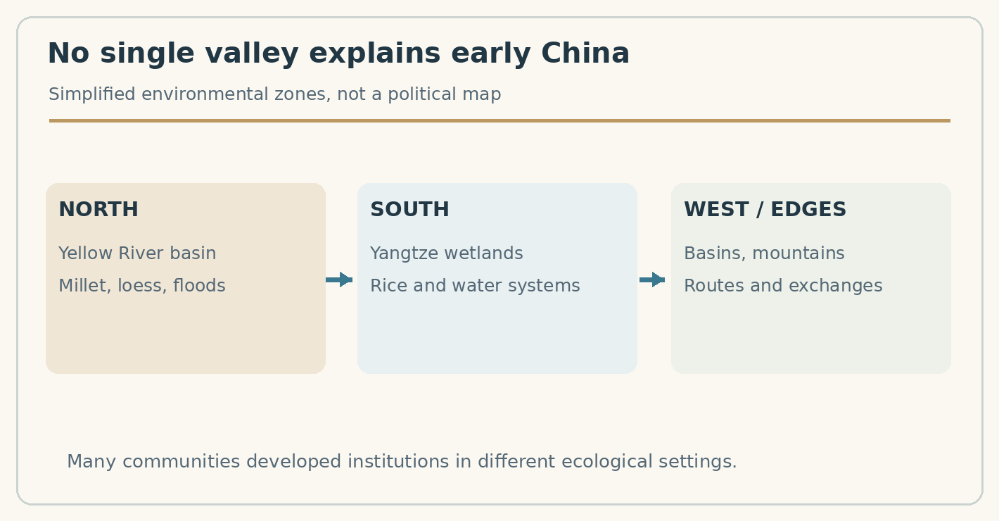

Огромният модерен план на Китай може да ни заблуди за древното си минало. Първите села и политически центрове не се развиват в една обединена държава. Жълтата река (Huang He) и нейните притоци помогнаха за подкрепа на общностите в северните части на Китай. По-на юг басейнът Яндзъ (Чанг Дзян) и влажните му зони поддържали различни земеделски традиции. Планините, басейните, платата, степните маршрути и бреговата линия насърчиха движението в някои посоки и го направиха по-трудно в други. Басейнът Съчуан и долната част на Янгдзъ не били просто далечни копия на средната жълта река. \[<a href="/014-ancient-china-dynasties-and-statecraft/sources/#source-4" class="cite">4</a>\]\[<a href="/014-ancient-china-dynasties-and-statecraft/sources/#source-5" class="cite">5</a>\]

Жълтата река носи огромни количества седименти от пейзажите, които включват лоис плато. Променящите се канали и наводнения могат да бъдат продуктивни и разрушителни. Системата Яндзъ заема друг екологичен свят с обширни валежи и влажни зони. Нито един от тях не трябва да бъде описан като перфектен дубликат на Нил, чийто модел на наводнение оформил Египет по характерни начини. Водата има значение, но никоя река не пише историята на династията предварително. Трудът за контрол на наводненията, конкуренцията за земя, сезонното време, производствените избори и войните зависели от човешките институции. \[<a href="/014-ancient-china-dynasties-and-statecraft/sources/#source-4" class="cite">4</a>\]

Думата "Китай" е полезна като модерно географско удобство в такова проучване; тя не трябва да означава, че неолитните фермери от всеки регион се считат за членове на една нация. Политическите идентичности, езици и граници са се променили в продължение на хилядолетия. Дългата историческа приемственост на Китай е реална във важни културни и институционални аспекти, но приемствеността не е същата като една непрекъсната, непроменена държава. В тази глава "ранен Китай" означава припокриване на археологически и исторически светове в територия, които сега формират части от Китайската народна република, а не предположение за древно единство.

<figure class="figure" id="figure-14-1">

<figcaption>Фигура 14.1. Различни речни басейни и екологични региони създадоха много пътища към ранните комплексни общества, а не политическа карта. <a class="figure-anchor" href="#figure-14-1" aria-label="Link to this figure">#</a></figcaption>
</figure>
