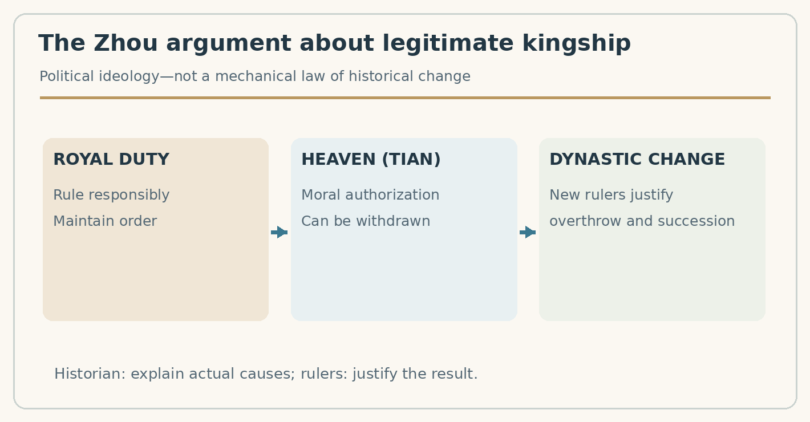

Джоу оправдава победата си, като твърди, че Небето (Тиан) е оттеглило благоволението си от Шанг и е поверил управлението на Zhou. По - късно един владетел, който се държал зле, пренебрегвал отговорността или допускал безредие, може да загуби тази санкция. Ключовият концептуален ход беше, че законната власт не е трябвало да принадлежи вечно към едно семейство: легитимността може да се обясни като условие за това как една династия управлява. Идеята се появява в ранната идеология на Жоу, но се развива чрез по-късни текстове и дебати, така че съвременните лозунги на учебника не трябва да се бъркат с нито една глаголна прокламация от всеки цар на Джоу. \[<a href="/014-ancient-china-dynasties-and-statecraft/sources/#source-18" class="cite">18</a>\]\[<a href="/014-ancient-china-dynasties-and-statecraft/sources/#source-19" class="cite">19</a>\]

<figure class="figure" id="figure-14-8">

<figcaption>Фигура 14.8. Мандатът на Джоу в Небесата обяснява твърдението за политическа легитимност, а не доказан механизъм за династична промяна. <a class="figure-anchor" href="#figure-14-8" aria-label="Link to this figure">#</a></figcaption>
</figure>

Това беше мощен отговор на проблема със завоеванията. Той също така създаде отново използваем политически аргумент. Успешни бунтовници или нови династии биха могли да кажат, че падналата къща е загубила благоволението на Рая. Такива твърдения са морално съдържание, но те също могат да бъдат самостоятелно: военна победа не сам по себе си установи, че завоевател действа справедливо. Историците трябва да разграничат твърденията на владетелите от това, което всъщност е причинило падането на режима. Влаченето, корупцията, пораженията на бойното поле и политическата нелоялност са конкретни процеси; Мандатът на Небето беше рамка за даване на тези събития на космическо и морално значение.

Разликата е важна днес. Да се каже, че Мандатът осигури език за критикуване на владетелите не е да се каже, че Джоу създаде модерна демокрация. Хората не се сдобиват с обикновен периодичен вот за царство. Нито трябва да се отнасяме към идеята като към обикновено религиозно суеверие без институционално въздействие. Идеологията може да промени стимулите и очакванията на елитите и общностите; владетелите, които твърдят морална легитимност, канят моралните оценки, дори ако силните хора решават кой може да говори и да бъде чут.
