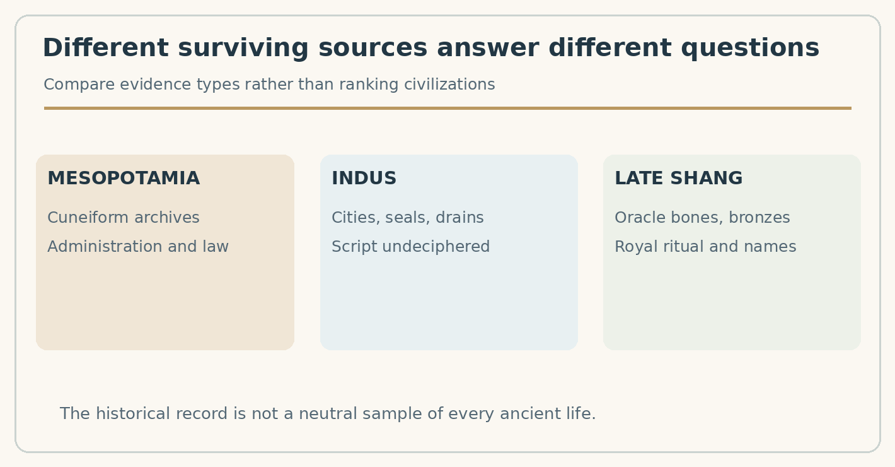

Сравнете градовете Инд, Месопотамия и ранния Китай без да ги принуждавате в класацията. В Месопотамия обширни административни таблети и литература оцеляват от различни периоди. В света на Инд, стандартизираната градска материална култура е видима, но нейните знаци не са общоприети дешифриране. За края на Шанг Китай четимите надписи осигуряват необичайно директен прозорец към кралския ритуал, родословието и вземането на решения; археологията дава на този прозорец физическа обстановка. Различните видове доказателства правят отговорите на различни въпроси. \[<a href="/014-ancient-china-dynasties-and-statecraft/sources/#source-2" class="cite">2</a>\]\[<a href="/014-ancient-china-dynasties-and-statecraft/sources/#source-3" class="cite">3</a>\]\[<a href="/014-ancient-china-dynasties-and-statecraft/sources/#source-11" class="cite">11</a>\]

Една клинописна сметка за ечемичено разпределение може да разкрие цифрови задължения. Дренажната система на Инд може да разкрие поддръжката и инженерството дори докато администрацията й остава неясна. Костта на Шанг Оракул може да разкрие, че кралят се притеснява за реколтата, но не и за общия размер на продукцията. Тези случаи показват защо е опасно да се твърди, че едно общество е "по-напреднало," само защото един вид оцелял обект е грандиозен или един архив е по-лесен за четене. Качеството на едно историческо твърдение зависи от съвпадането между въпрос и доказателства.

<figure class="figure" id="figure-14-11">

<figcaption>Фигура 14.11. Източникът се различава за Месопотамия, Индската цивилизация и покойния Шанг Китай. <a class="figure-anchor" href="#figure-14-11" aria-label="Link to this figure">#</a></figcaption>
</figure>

Те също така показват сходни проблеми: как да се организират земеделските ресурси, да се управляват отдалечени общности, да се даде убедителна форма на властта, да се създадат трайни символи и да се поддържат институциите, които функционират през поколенията. Отговорите бяха различни. Сравнителната история е най-силна, когато описва приликите като проверими модели и различия като исторически значими, вместо да намалява всички древни общества до един предсказуем път към съвременните държави.
