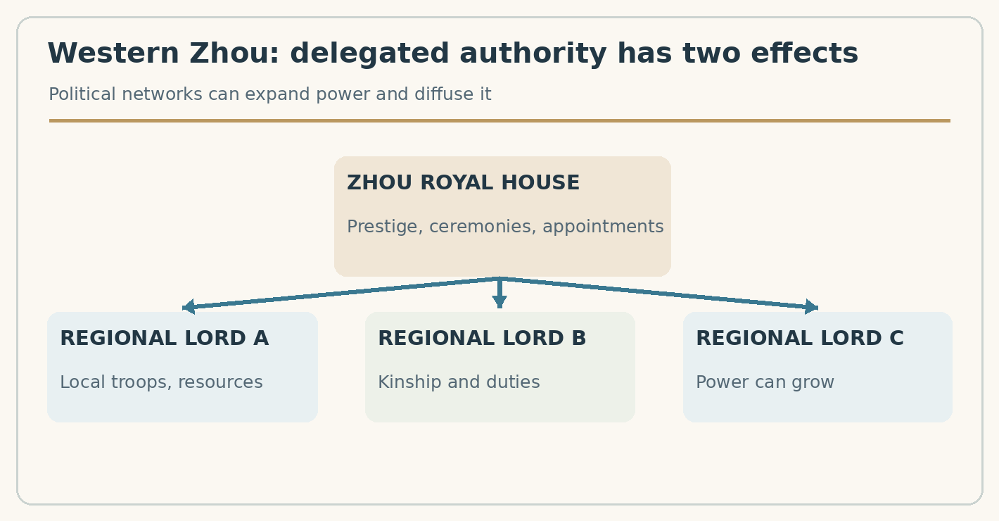

По време на периода Западен Джоу управляващата къща упражнявала известна власт над мрежа от регионални центрове. Силата на роднините и съюзническите аристократични връзки била от съществено значение за системата. Местните елити могат да командват земя и хора, докато признават ритуала и политическата позиция на краля Джоу. Въпреки това на разстояние царската власт зависела от взаимоотношения, които можели да отслабят, променят или да се оспорят. \[<a href="/014-ancient-china-dynasties-and-statecraft/sources/#source-11" class="cite">11</a>\]\[<a href="/014-ancient-china-dynasties-and-statecraft/sources/#source-18" class="cite">18</a>\]

Бронзови съдове от контекстите на Джоу понякога носят надписи, които отбелязват назначения, безвъзмездни средства, постижения или предци. Те са ценни, защото документират как един елит иска събитие да бъде запомнено. За разлика от надписите на покойния Шанг Оракул, някои бронзови текстове на Джоу са по-дълги записи на чест и родословие. Но все пак трябва да попитаме кой е поръчал надписа, на каква публика е служил и кои конфликти е пропуснал. Обявяването на кралско благоволение е доказателство, че някой иска да запише връзка с царя; неговите твърдения не трябва да се разглеждат като пълно преброяване на политическото подчинение. \[<a href="/014-ancient-china-dynasties-and-statecraft/sources/#source-18" class="cite">18</a>\]\[<a href="/014-ancient-china-dynasties-and-statecraft/sources/#source-20" class="cite">20</a>\]

<figure class="figure" id="figure-14-9">

<figcaption>Фигура 14.9. Регионалната делегация разшири авторитета на Джоу, като създаде мощни връзки със собствените си интереси. <a class="figure-anchor" href="#figure-14-9" aria-label="Link to this figure">#</a></figcaption>
</figure>

Системата Zhou илюстрира повтарящ се проблем на управляващата територия: делегацията създава както достъп, така и уязвимост. Когато кралят повери на регионалния господар военни и икономически ресурси, господарят може да защити кралския орден или да спечели възможността да му се противопостави. Бракът, церемонията, даването на подаръци и споделените предшественици могат да помогнат за поддържане на лоялността, но те не могат да премахнат конфликтите на интереси. Глава 7 нарича това система с обратна връзка: мощни регионални господари помагат на центъра проект мощност, и техният растеж също може да направи центъра по-малко необходим.
