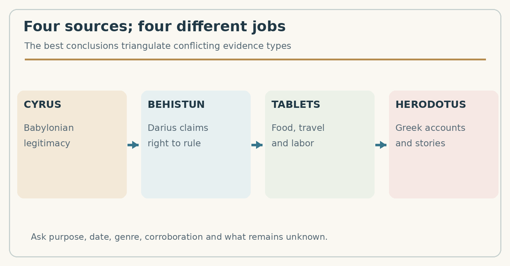

За да изучаваш персийското правителство, постави четири източника на въображаема маса. Първо е Кир Цилиндър, вавилонски текст, оправдаващ новия завоевател на традиционния царски език. Вторият е Бистун, монументален разказ на Дарий за оспорваното наследяване и бунт. Третото е дажбена таблетка Persepolis, малък рекорд за административно разпределение. Четвъртият е Херодот, гръцки автор с голям интерес към Персия, местните традиции и конфликта между Персия и гръцките градове. Четирите източника не са съгласни не само защото хората не са съгласни, но и защото всеки от тях е направен да върши друга работа.

Започни с жанра. Кралският паметник публично претендира за легитимност. Дажбен текст записва определена сделка или разпределение. Гръцки разказ организира истории за читатели и слушатели, понякога много години след едно събитие. Следващият въпрос за мащаба. Цилиндърът се отнася до завладяването на Вавилон и кралския образ, изграден около него. Бистун засяга присъединяването и победите на Дариус. Една таблетка се отнася до малка част от икономическата активност. Херодот варира между събитията, но не ги наблюдава директно. След това разгледайте какво липсва: реакциите на всички обикновени вавилонски семейства, всеки отделен бунтовнически разказ, личния живот на работник, наречен в една плоча, и персийски кралски документи за всяка война.

И накрая, да се развие претенция, която може да оцелее при контакт с четирите източника: "Ахеменидските царе използваха местни институции и административни ресурси, докато изграждаха силни претенции за кралска легитимност; в някои региони властта им беше жестоко оспорена." Това е достатъчно скромно, за да бъде подкрепено и достатъчно съществено, за да има значение. Това е по-добра отправна точка от "Cyrus изобретил човешките права" или "Persia е просто армия от роби." Висококачественото историческо писане често заменя драматичното, но невъзможно твърдение с пластово, изпитано обяснение.

<figure class="figure" id="figure-15-12">

<figcaption>Фигура 15.12. Триангулирането на кралските претенции, административните записи и гръцките текстове води до по - надеждни заключения. <a class="figure-anchor" href="#figure-15-12" aria-label="Link to this figure">#</a></figcaption>
</figure>
