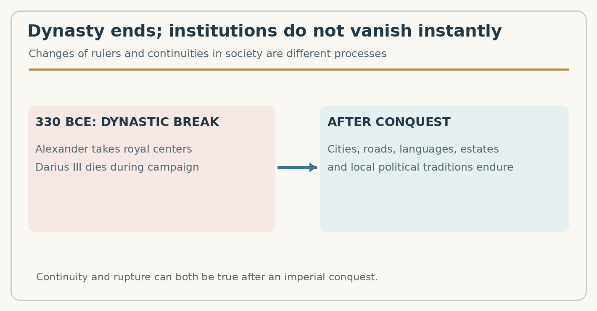

През 334 г. пр.н.е. Александър III от Македон преминава в Азия и започва кампания срещу Ахеманидската монархия. Неговите сили спечелиха големи битки, включително Исус през 333 и Гаугамела през 331 г. пр.н.е., срещу армии, свързани с Дарий III. Авансът на Александър го пренасял през ключови императорски центрове; Персеполис бил заловен и изгорен през 330 г. пр.н.е. Дариус III е бил убит по време на кампанията същата година. Управлението на династията Ахеменид приключи, но хората на империята, пътищата, градовете, имотите и административните навици не изчезнаха за една нощ.

Бойното поле не е цяло правителство. Александър зависеше от съществуващите мрежи, за да премести войските си, да осигури храна, да поиска приходи и да комуникира в непозната територия. Той се възползвал от местните елити и аспектите на персийската съдебна практика, избор, който може да ядоса македонските му другари. Новият ред бил нестабилен, а смъртта на Александър през 323 г. пр.н.е. довела до борби сред неговите наследници. И все пак, неговото завоевание показва разликата между края на династия и разтварянето на всяка система, която династията е изградила.

Трябва да се противопоставим на две исторически неизбежности. Първо, успехът на Александър не доказва, че Персия била безпомощна или всемирно мразена. Резултатите от кампанията зависят от военната тактика, лидерството, местните съюзи, съдебната политика и шансовете. Второ, оцеляването на имперските практики не доказва приемственост без прекъсване. Войните убиват хора, сменят елитните мрежи и променят центровете на властта. Наследството на Ахеменид било отчасти материално, укрепени маршрути, архиви и частично институционални: по-късно владетелите се научили да работят с огромна територия, която преди това била свързана с персийското царство.

<figure class="figure" id="figure-15-11">

<figcaption>Фигура 15.11. Монархията на Ахаеменида завършила при Александър, но много социални и административни системи издържали. <a class="figure-anchor" href="#figure-15-11" aria-label="Link to this figure">#</a></figcaption>
</figure>
