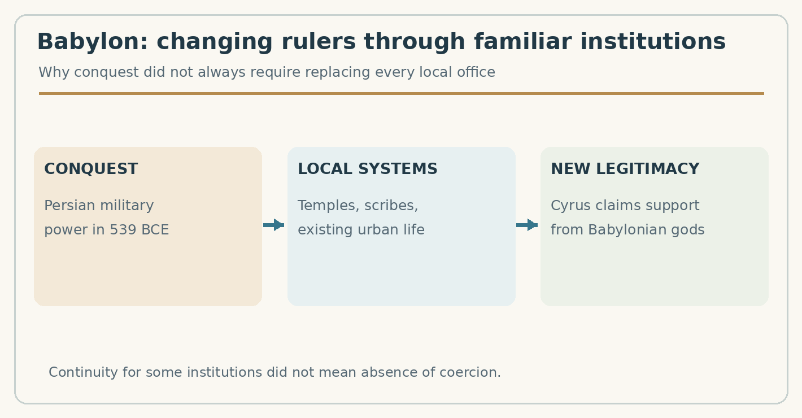

Вавилон бил център на една важна Месопотамска империя и останал град, чиито религиозни традиции носели изключителен престиж. Силите на Кир победили вавилонската военна съпротива през 539 г. пр.н.е. и градът бил под персийското управление. Съвременните вавилонски източници, включително Хрониката на Набонид и Цилиндър Кир, ни помагат да изследваме прехода от по - близо до събитието от разказа на Херодот. Тези документи не са съгласни с всеки детайл с най-пъстроцветните гръцки сметки.

Ключовото историческо прозрение е, че Кир не се представил само като чужд завоевател. Във вавилонска обстановка той можел да говори традиционния език на Месопотамското царство: легитимност, предоставена от Мардук, защита на храмовете, възстановяване на реда и грижа за града. Това беше интелигентен политически превод. Един владетел, който искал вавилонско сътрудничество, имал причина да се направи разбираем в рамките на вавилонските очаквания. Персийската идентичност не попречила на царя да използва вавилонски политически речник.

Какво се промени за обикновените хора? За някои книжници системата за записване на земята, плащанията и задълженията продължава. За някои храмови общности царската подкрепа може да е възстановена или преразпределена. За кралското семейство и войниците на победеното правителство, завоеванието означавало загуба и опасност. Наличните доказателства са неравни; не бива да си представяме, че можем да изследваме всички вавилонски семейства. Въпреки това епизодът показва една обща императорска техника: един цар може да твърди, че възстановява местния ред, докато пренасочва върховната власт към себе си.

<figure class="figure" id="figure-15-3">

<figcaption>Фигура 15.3. Персийското завоевание можело да съществува едновременно с приемствеността на местните племенни и религиозни институции. <a class="figure-anchor" href="#figure-15-3" aria-label="Link to this figure">#</a></figcaption>
</figure>
