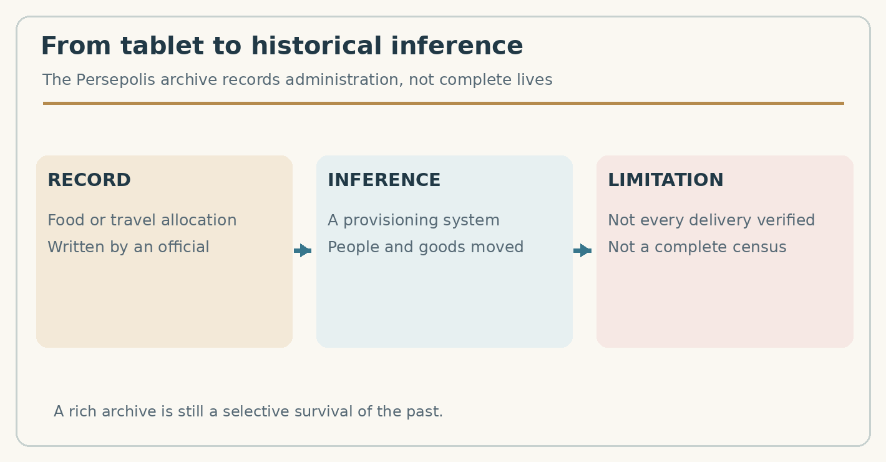

През ХХ век разкопките открили десетки хиляди административни плочи в Персеполис. Архивът на крепостта Персеполис, датиращ главно от управлението на Дариус, записва аспектите на разпределението на храната, разрешенията за пътуване, длъжностни лица, работни групи и движение в рамките на имперското сърце. Много документи са написани в Еламите, а не в Стария Персиец. Това е напомняне, че една политическа империя и нейната ежедневна документация могат да използват различни езици. Кралските надписи ни казват как кралят искал да бъде запомнен; обикновените таблети показват организацията, необходима за хранене на хората и преместване на ресурси.

Архивът променя начина, по който разбираме икономиката. Тя записва големи административни системи с дажбени везни и прехвърляне на стоки, а не просто мистериозни съкровища, съхранявани в дворци. Някои вписвания се отнасят до жените като получатели на разпоредби или като лидери на работни групи, а някои са свързани с раждане. Тези подробности оспорват твърдението, че императорската икономика е направена изцяло от мъже във военни униформи. Но една таблетка, която придава зърно, не ни казва всичко за свободата, щастието, структурата на домакинството или правния статут на получателя.

Представете си да намерите влизане, разрешаващо зърно за група работници. Сигурността на наблюдението е, че длъжностно лице е записало определено разпределение. С повече документи можем да включим модел на осигуряване. За да заключим, че всеки работник е получил точно написаната сума, ще се нуждаем от потвърждение; записите могат да бъдат непълни, измамни, вдъхновяващи или ограничени до определени институции. Архивът на Персеполис е изключително ценен именно защото позволява на историците да се движат от широки кралски претенции към конкретни системи, но все още е фрагмент от империята, а не преброяване на всички, които са живели в нейните граници.

<figure class="figure" id="figure-15-9">

<figcaption>Фигура 15.9. Записано разпределение позволява целеви извод, но не пълна биография на неговия получател. <a class="figure-anchor" href="#figure-15-9" aria-label="Link to this figure">#</a></figcaption>
</figure>
