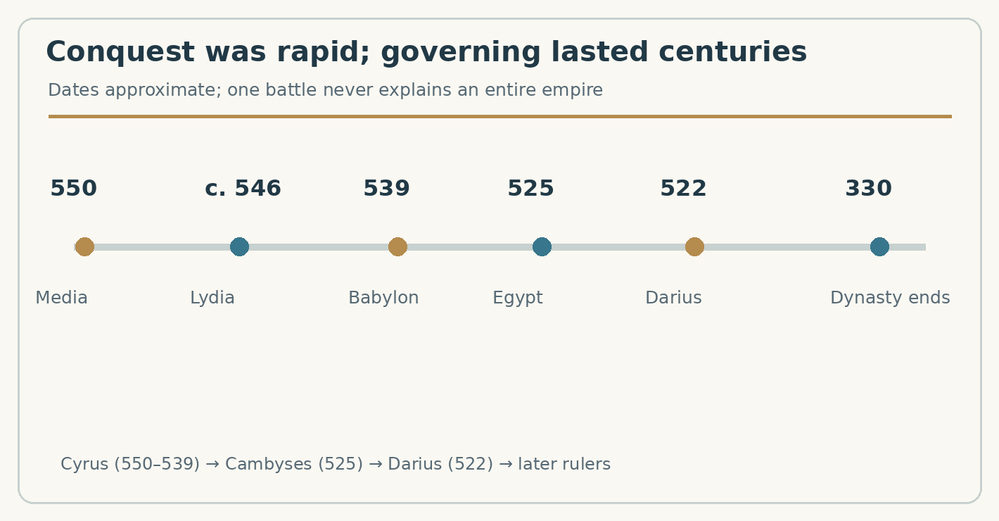

Кир II, запомнен като Кир Велики, управлявал Персия преди 550 г. пр.н.е. и се появил като архитект на разширяваща се империя. Около 550 той победи Astyages of Media, трансформирайки връзката между иранските сили. През 540-те години той въвел Лидия в своя контрол, разширяване на персийското влияние върху Егейското крайбрежие; обичайният учебник дата за падането на Лидия е 547/546 BCE, въпреки че подробната последователност остава разисквана. През 539 г. пр.н.е. войските му завладяли Вавилония. В рамките на малко повече от десетилетие политическата карта на Западна Азия била преправена.

Тази скорост е поразителна, но хронологията на заловените столици крие голяма част от историята. Сайръс се нуждаел от съюзи и опитни местни администратори. Завоюваните елити могат да изберат да си сътрудничат, защото техните имоти и позиции биха могли да оцелеят под ново управление. Други можели да устоят и империята използвала военна сила, за да ги победи. Не можем да възстановим всяка сделка. По - късно разказите, особено от гръцкия историк Херодот, преплитат ценни традиции с драматични разговори и запомнящи се морални приказки. Хронологията има по-силна документална подкрепа от точните думи на Сайръс преди битка.

Една държава може да се разшири бързо, когато нейните опоненти са политически разделени, когато тя наследява съществуващи транспортни и данъчни системи, и когато завладяването носи ресурси, които финансират по-нататъшни завоевания. Това е укрепващ процес, както обясни глава 7. Той създава и балансиращ проблем: новозавоюваните земи изискват войски, легитимност и администрация. Способността на Кир да завземе властта в широк район не направила империята трайно сигурна. Неговите наследници биха похарчили голяма част от енергията си, управлявайки това, което е спечелил.

<figure class="figure" id="figure-15-2">

<figcaption>Фигура 15.2. Хронологичните котви показват бързо завоевание и продължително поддържане на имперската власт; датите са закръглени. <a class="figure-anchor" href="#figure-15-2" aria-label="Link to this figure">#</a></figcaption>
</figure>
