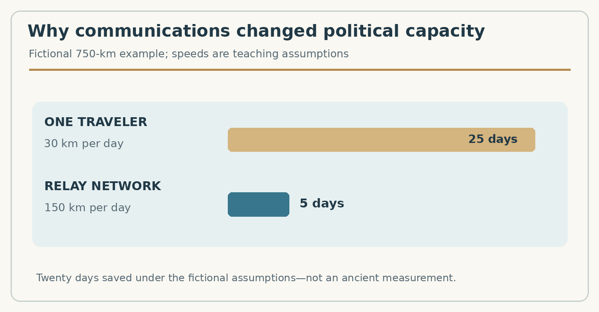

Светът на Ахеманид свързва множество съществуващи маршрути и подобрява някои важни коридори. Известният "Royal Road" е свързан по-специално с маршрута между Сардис и имперската земя около Суза, въпреки че империята използва множество пътища, водни пътища и регионални мрежи. Херодот описва реле куриери и постановки. Не трябва да си представяме мигновена, перфектно единна пощенска услуга във всяко село. Важните иновации са били поддържан от държавата комуникационен капацитет, работещ чрез основни маршрути и точки на доставка.

Представете си съобщение, което се движи 750 километра между два хипотетични административни центъра. Един пътешественик средно 30 километра на ден би изисквал 25 дни, игнорирайки прекъсванията. Реле мрежа, доставяща съобщения със средно 150 километра на ден, ще носи съобщението за пет дни. Тези избрани скорости са просто изчисление на обучението, а не проверени средни стойности за персийския съд. Политическата разлика е огромна: след като получи заповед, провинциалният управител може би все още ще трябва да събира хора или доставки, но пет дни, а не двадесет и пет биха могли да позволят смислен отговор преди промените на събитията.

Пътищата не само носеха команди. Те помогнаха на търговците да движат стоки, армии концентрират силите си и длъжностни лица контролират провинциалните мрежи. Също така улесниха изтеглянето. Един ефективен път може да отнесе зърно към царския склад или да транспортира войници към непокорна общност. Инфраструктурата рядко е морално едностранна; тя разширява капацитета за действие. Въпросът е кой контролира този капацитет и кой плаща за него.

<figure class="figure" id="figure-15-7">

<figcaption>Фигура 15.7. Хипотетично сравнение показва защо релените мрежи са променили реакцията на правителството. <a class="figure-anchor" href="#figure-15-7" aria-label="Link to this figure">#</a></figcaption>
</figure>
