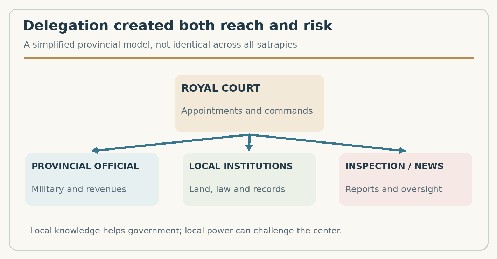

Империята от огромни територии не може да се управлява така, сякаш всяко решение идва директно от една зала. Achaemenid царете използват провинциални управители, известни с гръцко-получения термин сатрапи, за да управляват територии. Длъжностни лица се занимават с данъчно облагане, военни нужди, комуникация, правосъдие и взаимоотношения с местните елити, въпреки че договореностите се различават по период и провинция. Някои позиции били заемани от членове на кралското семейство или влиятелните персийски аристократични семейства; много местни институции продължавали да функционират под тях.

Изкушаващо е да си представим чиста карта с идентични провинции и еднакви правила. Древните доказателства поддържат по-неравномерна реалност. Гръцките източници описват сатрапиите, а административните документи разкриват припокриващи се юрисдикции. Една наречена провинция с кралски надпис не е непременно същото нещо като фискална област или областта, пряко командвана от един управител. Границите, задълженията и титлите са променени. Някои територии плащали данъци; други обзавеждали стоки, войски или подаръци по реда на договорености, които не винаги били стандартизирани.

Проблемът с управлението беше баланс между местните знания и централната лоялност. Губернаторът, който разбира местните езици и модели на земя, може да събира приходи по-ефективно. Губернатор, който е командвал твърде много войски или е изградил силни местни съюзи, може да предизвика съда. Кралски инспектори, военни командири, касиери, съперници аристократи и чести комуникации предложили на краля начини да наблюдава провинциалните дела, но не надзор елиминирали рисковете от разстояние. Системите на делегиране по същество не са слаби: те са от съществено значение в големите организации. Тяхната слабост се проявява, когато стимулите отдалечават местните длъжностни лица от централните приоритети.

<figure class="figure" id="figure-15-6">

<figcaption>Фигура 15.6. Сатрапите и местните власти разшириха царския контрол, като същевременно създадоха проблеми с надзора и лоялността. <a class="figure-anchor" href="#figure-15-6" aria-label="Link to this figure">#</a></figcaption>
</figure>
