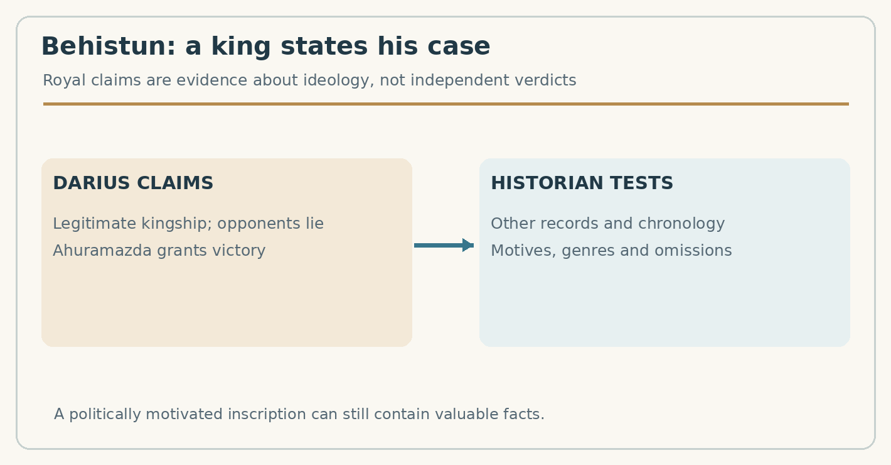

След смъртта на Камбизес през 522 г. пр.н.е. империята изпаднала в тежка политическа криза. Дариус аз взех трона, и въстания избухнаха в няколко региона. Неговият велик надпис в Beistun (също написа Bisotun), издълбан на скала в западен Иран, разказва една много организирана история: измамник узурпатор е превзел трона, Дарий унищожи самозванеца, божественото благоволение го подкрепи, и той победи поредица от бунтовници, които излъга за тяхната легитимност. Текстът се появява в Стария Персийски, Еламитски и Вавилонски, което прави паметника важен както като политическа пропаганда, така и за по-късно дешифриране на клинопис.

Надписът е пряко доказателство, че Дариус иска твърденията му да бъдат запомнени по определен начин. Не е независимо доказателство, че всеки съперник е бил измамник, нито че спорът за трона се е разгърнал точно както той е докладвал. Един владетел, който се появи от оспорваната наследяване имаше мощни стимули да определи опонентите като "лъжци" и себе си като представител на реда. Това не прави надписа безполезен. Тя ни казва имена, кампании, кралска идеология и внимателно инсценирана структура на новата царска обосновка, която може да бъде тествана срещу други източници.

За исторически разсъждения, сравни паметника на Дарий с този на Сайръс Цилиндър. И двете комуникират с местните традиции, както оправдават новия владетел, така и двете са избирателни. Цилиндърът говори на вавилонски религиозно-политически език след завоевания; Бехистун подчертава легитимността на Дариус и наказанието на бунта след граждански конфликт. Те са различни жанрове, които служат на свързаните с тях политически цели. Признаването на интерес зад източника означава да задаваш по-остри въпроси, а не автоматично да обръщаш всяко твърдение.

<figure class="figure" id="figure-15-5">

<figcaption>Фигура 15.5. Дарий оформил историята за присъединяването си; надписът изисква критично потвърждение. <a class="figure-anchor" href="#figure-15-5" aria-label="Link to this figure">#</a></figcaption>
</figure>
