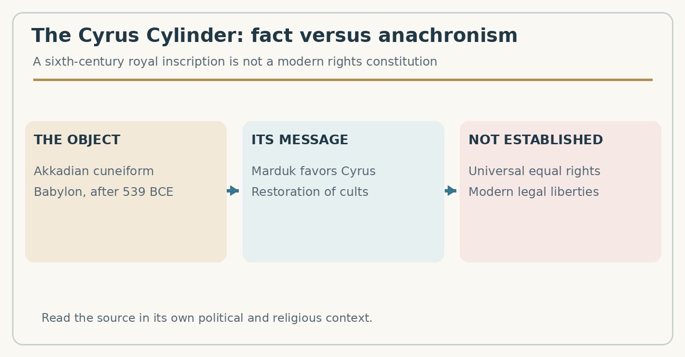

Цилиндърът Кир е глинен обект, написан във вавилонска акадийска клинопис след завоеването на Кир. Текстът представя Кир благосклонно, атакува легитимността на предишния владетел Набонид и свързва новия крал с бог Мардук. В него се описва възстановяването на култовите уговорки и завръщането на изместени божествени изображения или общности на език, подходящ за мезопотамските кралски надписи. Тъй като е била депозирана в контекста на фондацията, тя не е проектирана като модерен публичен манифест, предаден на всеки гражданин.

В съвременните тържества Цилиндърът понякога се нарича първата харта на правата на човека. Тази интерпретация е привлекателна, особено за хората, които търсят обнадеждаващ древен пример на толерантност. Документът обаче не формулира равни индивидуални права, представително правителство, свобода на словото или всеобщо право да избираш религията си. Древната кралска легитимност и съвременните правни права са различни политически езици. Цилиндърът все още може да предостави важни доказателства за предпочитания от Кир имидж и определени политики; коригирането на анахронизма не изисква отхвърляне на историческата му стойност.

Обърни внимание на разликата в три стъпки. Текст: Кралят твърди, че е възстановил култовия ред и е бил облагодетелстван от Мардук. Относно: Новият режим търсеше сътрудничество чрез познати местни религиозни институции. Твърденето на текста не може да подкрепи: империята признава всяко човешко същество като носител на равни съвременни граждански права. Това е точно методът на разсъжденията от глава 4: автентирай източника, идентифицирай целта му, потвърди събитието и не го моли да докаже повече, отколкото може.

Ние също трябва да внимаваме да свържем един единствен кралски документ с всяко движение за връщане, споменато в други традиции. Еврейската Библия помни персийската политика като важна за възстановяването на еврейския общ и религиозен живот, особено в Йерусалим. Тези текстове имат значение, но техният състав, хронология и жанрове изискват исторически анализ. Нито Цилиндърът, нито библейските разкази трябва да се третират като прозрачно ръководство за политиката в цялата империя.

<figure class="figure" id="figure-15-4">

<figcaption>Фигура 15.4. Сайръс Цилиндър е древен иск за легитимност, а не харта на съвременните универсални човешки права. <a class="figure-anchor" href="#figure-15-4" aria-label="Link to this figure">#</a></figcaption>
</figure>
