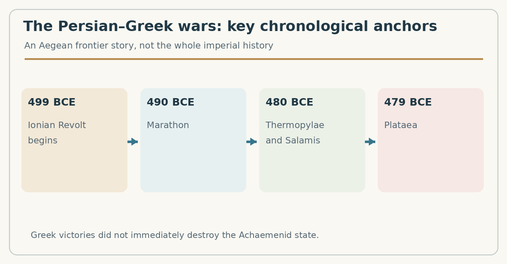

Конфликтът между Персия и гръцките градове често се разказва сякаш това е била основната цел на историята на Ахемените. За персийския двор Егейският свят бил важна, но ограничена част от една империя, която се занимавала едновременно с много региони. Йонийският бунт започва през 499 г. пр.н.е. сред гръцкоговорящите общности под персийското господство в Анадола, с участието на континентални гръцки държави. Кампанията на Дариус срещу Атина завърши с персийското поражение при Маратон през 490 г. пр.н.е. При Ксеркс голямото нашествие през 480 г. пр.н.е. включвало битките за Термопилите и военноморската битка при Саламин; гръцката съюзническа победа в Платая през 479 г. пр.н.е. помогнала да се сложи край на континенталната инвазия.

Тези дати са полезни котви, но не могат да заместят обяснението. Гръцките поляци били политически разделени, а някои сътрудничили на Персия. Персийските командири и войници не били нито една необмислена маса. Резултатът отразява география, военноморска организация, съюзи, логистика, стратегия и политически избори от двете страни. Популярните двоични "свободни гърци срещу поробени персийци" крият различия между гръцките конституции и разнообразния опит на персийските имперски поданици. В крайна сметка успехът на гърците в защитата на голяма част от континента им не унищожи Персийската империя.

Херодот е незаменим за много епизоди, но пише от гръцки литературен и политически свят. Трагедията на Ешилус Персийците предлага още една гръцка перспектива, изтънчена и хуманност на места, които все още не са персийски дворцов архив. Трябва да прочетем тези автори заедно с персийските надписи, археологията и административните записи, като отбележим, че доказателствата са много различни за речите на бойното поле и дългосрочното провинциално данъчно облагане. Гръцката победа може да бъде истинска, а гръцката интерпретация на мотивите на врага все още може да се оспорва.

<figure class="figure" id="figure-15-10">

<figcaption>Фигура 15.10. Персийските гръцки конфликти били пограничен епизод в много по-дълга имперска история. <a class="figure-anchor" href="#figure-15-10" aria-label="Link to this figure">#</a></figcaption>
</figure>
