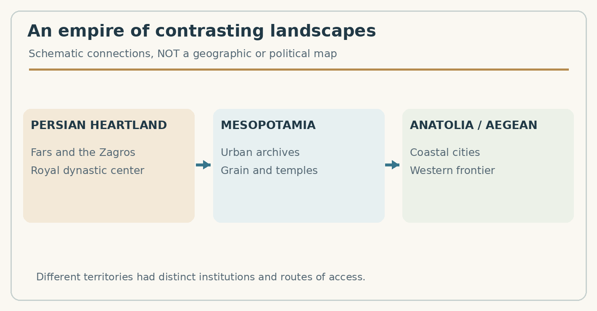

Древните персийци се появили в един голям и неравен ирански свят. Планините Загрос, иранското плато, долините около древния Елам и сухите пейзажи на изток създадоха пачове от маршрути и селища. Югозападно от планините, областта Персийците нарича Парса, като цяло региона на съвременните Fars в Иран, предлага както политическа страна и връзки с по-стари градове. На северозапад са разположени Медиите; на запад Месопотамия; на север и изток разнообразяват планинските и степните общности. Следователно географията на персийската държава не била изолирана пустинна крепост. Това беше кръстопът между селскостопанските райони, пасторалните народи и големите имперски предшественици.

Планинската верига може да приютява общности от армия, но също така насочва армиите към проходи. Пустинята може да обезкуражи небрежното пътуване, но караваните с известни кладенци могат да го прекосят. Разстоянието между иранския интериор и Вавилон има значение, защото посланията, войниците и провизиите трябваше да го пресичат многократно. Ние трябва да устоим на позната грешка от глава 5: планините не произвеждат автоматично твърди войни, а реките не произвеждат автоматично империи. Човешките институции решават как да използват възможностите, които предлага пейзажът.

Името "Персия" е удобно за тази династия, но не трябва да изравнява всяка общност от региона в един етнически или език. Мидяните, персите, Еламитите, вавилонците и много други народи запазили различни идентичности. Границите на съвременния Иран не са границите на древната империя, а по-късната история на иранските народи е много по-дълга от периода на Ахеменид, традиционно датирана около330 BCE. Терминът Achaemenid идентифицира кралска династия и неговия политически ред, не всеки период в персийската история.

<figure class="figure" id="figure-15-1">

<figcaption>Фигура 15.1. Ранната персийска земя свързва няколко екологични и политически свята; диаграмата не е териториална карта. <a class="figure-anchor" href="#figure-15-1" aria-label="Link to this figure">#</a></figcaption>
</figure>
