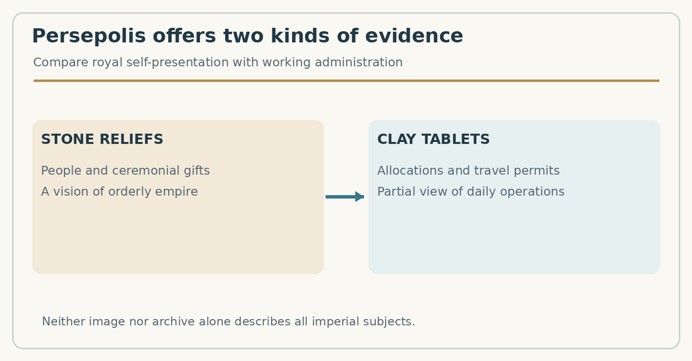

Много империи са въведени сякаш притежават един капитал, една сграда, от която всяка команда излъчва. Achaemenid царете са имали множество кралски центрове с припокриващи церемониални, жилищни и административни функции. Пасардаде, основан под ръководството на Кир в персийската земя, отбелязвал династичното начало. Суса е важен по-стар град Еламите, разработен като кралска резиденция. Вавилон запазил своето икономическо и символично значение. Персеполис, основан под Дарий близо до края на шести век пр.Хр., изразява величието и последователността на царуването на монументална тераса.

Персеполис е особено запомнящ се за релефи, които показват представители на различни земи, внимателно изваяни дрехи и животни, шествие сцени, колони и огромни порти. Тези снимки не са били снимки на конкретна доставка на данъци. Те построили видение за йерархията: много народи се организирали мирно около царя. Изкуството предлага доказателства за императорско самопредставяне и може би аспекти на съдебната церемония, но ние не трябва да предполагаме, че всички провинции доброволно приемат равни отношения с короната. Изображенията на хармонията могат да съществуват заедно с историите на съпротивата.

Няколко кралски центрове били предимство в една географски разнообразна империя. Съдът може да остане свързан с различни провинции и традиции, а съществуващите градски системи остават полезни. Разходите бяха реални: големи домакинства, занаятчии, хранителни доставки, животни, длъжностни лица и архиви трябваше да се движат или да бъдат поддържани на различни места. Царят бил не само индивидуален владетел, но и център на пътуваща институция, която изисквала изключителни организационни възможности.

<figure class="figure" id="figure-15-8">

<figcaption>Фигура 15.8. Монументални кралски изображения и практически административни таблети осветяват различни аспекти на имперското управление. <a class="figure-anchor" href="#figure-15-8" aria-label="Link to this figure">#</a></figcaption>
</figure>
