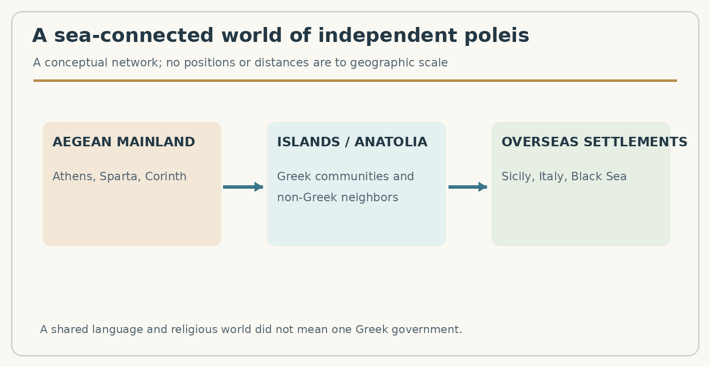

Географията влиза в тази история, но не е съдба. Южният Балкански полуостров е разделен на планински вериги, тесни долини и брегове с много природни пристанища. През Егейско море се намират острови и западните брегове на Анадола. Моряците можели да свързват общности, разделени от вода, по-лесно отколкото някои съседни вътрешни селища можели да прекосят неравен терен. Средиземно и Черно море бяха магистрали на миграцията, търговията, пиратството, войната и културния обмен. В крайна сметка гръцкоговорящи селища окупирали места, отдалечени от южна Италия, Сицилия, Северна Африка и Черно море.

Хората, които наричаме древни гърци, използвали езици и диалекти, свързани помежду си, почитани припокриващи се богове и развили институции, които да ги накарат да признаят споделените обичаи. Въпреки това по време на архаичните и класически периоди не е имало нито едно трайно гръцко правителство. Гръцкият полис не бил миниатюрна държава в съвременния смисъл на думата. Това беше политическа общност, свързана с град, провинцията, домакинствата, култите, законите и признатите членове. Територията около Атина, наречена Атика, включвала села и ферми далеч отвъд нейните стени. Спарта управляваше обширна територия в Лакония и Месения. Другите поляци били достатъчно малки, за да се познават лично.

Когато цветна карта обозначава цяла Егейско море "Гърция," попитайте кой вид претенция прави. Гръцкият език, гръцките културни мрежи и гръцкият суверенитет не бяха идентични. Границите са променени. Обществото може да сподели празник със съседните гърци, докато се бори с тях за земеделски земи или съюзник с чужд цар. Това многократно напрежение между културната принадлежност и политическата независимост направи гръцкия свят изобретателен и нестабилен.

<figure class="figure" id="figure-16-1">

<figcaption>Фигура 16.1. Гръцките културни мрежи достигат през моретата, без да създават единно правителство. <a class="figure-anchor" href="#figure-16-1" aria-label="Link to this figure">#</a></figcaption>
</figure>
