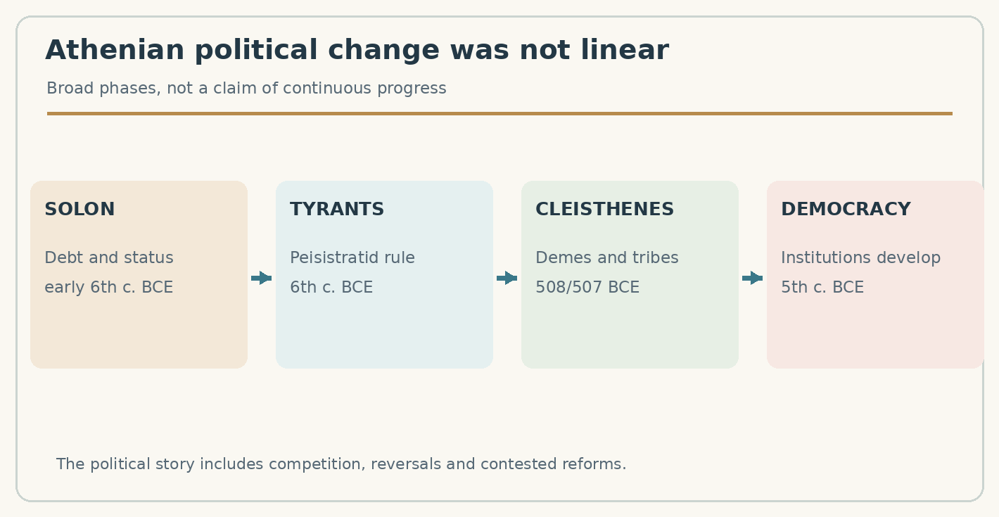

Около 508/507 BCE Клистенс се свързва с реформи, които реорганизират атинянското гражданско тяло. Гражданите принадлежали на местни райони, наречени "деми" и били организирани в десет нови племена, привличащи членове от различни региони на Атика. Това нарушило някои по - стари регионални и аристократични подравнявания. Съветът от петстотин души, заедно с петдесет членове, свързани с всяко племе, осигури механизъм за подготовка на обществения бизнес и координиране на държавните дела. Реорганизирането не реши внезапно всеки елитен конфликт, но направи политическата общност по-тясно свързана с институциите и базираната на резиденцията гражданска регистрация.

Езикът на изономия, често смятан за равенство преди или съгласно закона, се появява в по-широкия политически речник на периода. Нейната връзка с това, което днес наричаме демокрация, е сложна; нашите оцелели разкази бяха написани след събитията и могат да отразяват по-късните идеали. Важното е, че политическата организация може да направи гражданин повече от зависим последовател на могъщо домакинство. Публичните служби и споделените процедури дадоха нова форма на колективни действия.

Защо тези институционални детайли били важни? Представете си състояние, в което всяко село е свързано само чрез най-близкото си благородно семейство. Такива семейства могат да се пазарят като частни блокове. Сега си представете регионални групи умишлено смесени в рамките на граждански съвет. Реформата не елиминира неравенството, а може да създаде нови мрежи от задължения и информация. Географията се превръща в политика. Уроците от глава 7 важат тук: реорганизирането на членството на системата може да промени стимулите дори и без да променя вярванията на всеки човек.

<figure class="figure" id="figure-16-4">

<figcaption>Фигура 16.4. Атинските институции се промениха чрез конфликти, реформи и периоди на концентрирано управление. <a class="figure-anchor" href="#figure-16-4" aria-label="Link to this figure">#</a></figcaption>
</figure>
