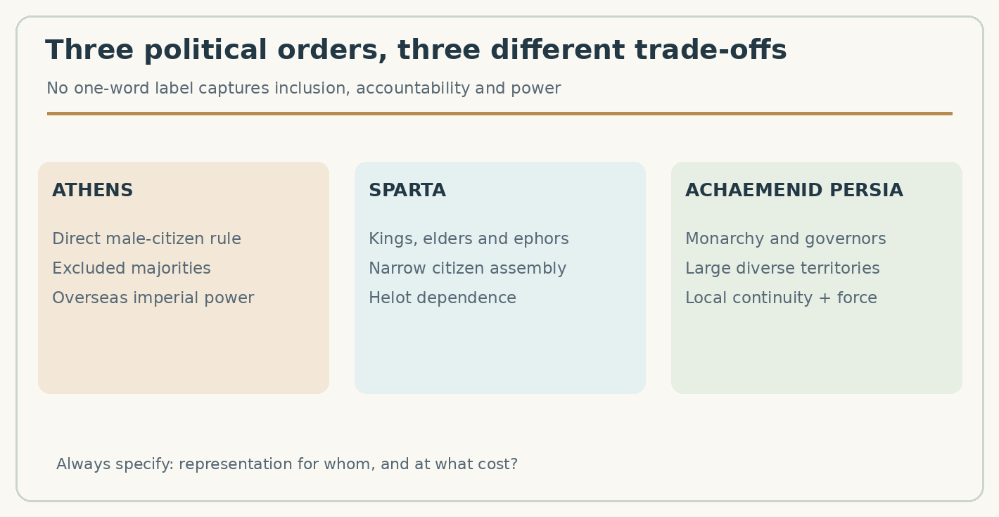

Сложи три политически заповеди един до друг. Атина експериментира с широко пряко участие сред възрастни мъжки граждани, редуване по жребий и обществен аргумент, но изключва голяма част от населението си и управлява отвъдморска империя. Спарта раздава власт сред царете, ефорите, старейшините и едно събрание на гражданите, като същевременно концентрира пълното политическо членство в малко тяло, подкрепяно от хелитния труд. Империята Ачеменид, от глава 15, управляваше огромни територии чрез монархия, провинциални посредници, административна приемственост и военна власт; тя разрешаваше форми на местно разнообразие, без да дава на субектите равен контрол върху имперските решения.

Коя система беше най-добра? Отговорът зависи от критерия: възможност на гражданите да участват, сигурност от насилие, третиране на изключените популации, капацитет за координиране на ресурсите, стабилност или защита от произволен владетел. Не можем да намалим тези измерения до един морален индекс. Директното участие не осигурява автоматично индивидуални права; множество офиси не включват автоматично мнозинството; толерантната местна администрация не прави империята демократична. Историческото сравнение става полезно, когато посочваме точно коя институционална характеристика и какъв резултат сравняваме.

Опитай още едно сравнение с настоящето. Съвременната парламентарна демокрация обикновено разчита на избрани представители, широко пълнолетно избирателно право, професионална администрация и права, защитени чрез конституции или закони. Класическа Атина не е имала точно този пакет. Използването на думата демокрация и за двете може да бъде просветление, при условие че кажем какво се промени: границите на гражданството, начините на представителство, мащаба, участието и правната защита. Гърците ни дадоха трайни политически въпроси, а не ръководство за експлоатация.

<figure class="figure" id="figure-16-12">

<figcaption>Фигура 16.12. Различни древни политически заповеди са имали различни институции и различни изключвания. <a class="figure-anchor" href="#figure-16-12" aria-label="Link to this figure">#</a></figcaption>
</figure>
