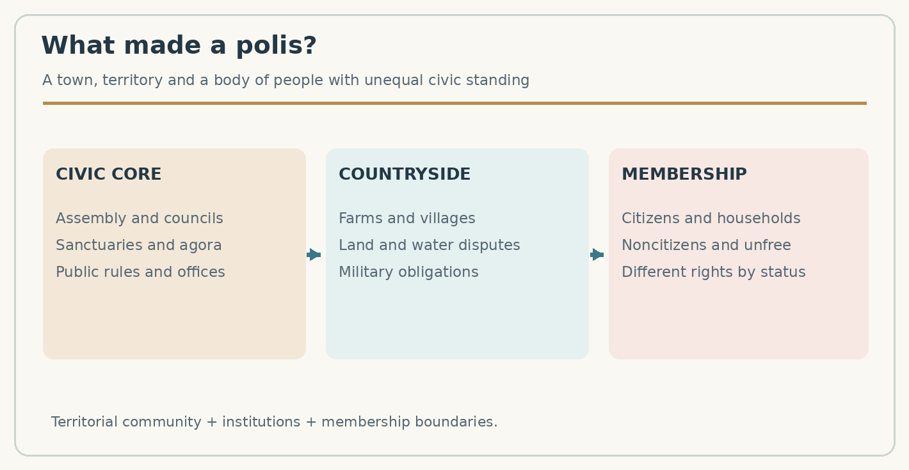

Между девети и седми век пр.н.е. много гръцки общности са претърпели растеж на населението, промени в селскостопанската организация, разширяване на обмена и нови форми на обществен живот. Храмовете и светилищата се превърнали във фокусни точки. Общностите построили стени, определени територии, разработили съвети и започнали да записват правила. Агората може да служи като място за пазарно и гражданско събиране; акропола може да бъде защитна височина или свещен център. Конкретното споразумение се различаваше от полиса до полиса.

Защо хората биха приели общ политически ред, вместо да разчитат изцяло на могъщи семейства? Един полис може да организира отбрана, да урежда спорове, да управлява общи култове, да разпределя земя и да координира отношенията си с външни хора. Правилата биха могли да ограничат неофициалните решения, въпреки че тези, които са направили правилата, остават спорни. В един град може да има аристократични магистрати, старейшински съвет, по - широк конгрес или изключителен владетел. Политическата промяна често се водеше от борби за земя, дълг, наследство, военна служба и социалното положение на проспериращите домакинства извън най-старите елитни семейства.

Полисът е едновременно пространство за колективна идентичност и институция, създаваща граници. Неговите граждани може да притежават правна защита и признат глас, отказан на негражданите. Аргумент, който следва да се прилага спрямо гражданите, би могъл да съществува съвместно с използването на заловен труд. Този двойствен характер ще се появява многократно: политическото включване за една група може да бъде изградено при изключване на друга.

<figure class="figure" id="figure-16-2">

<figcaption>Фигура 16.2. Полис комбиниран граждански пространства, провинцията и неравностойни категории членство. <a class="figure-anchor" href="#figure-16-2" aria-label="Link to this figure">#</a></figcaption>
</figure>
