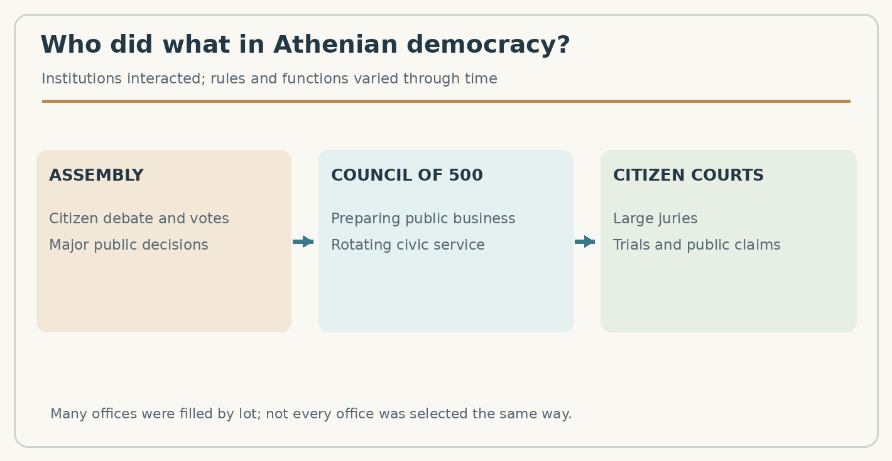

До пети век пр.н.е. Атина е развила отличителна форма на пряко гражданско участие. Еклесия, или Събрание, събра допустими мъже граждани, за да обсъдят и гласуват по важен бизнес: война и мир, политика, укази и някои публични решения. Съветът на Петстотинте подготвени бизнес, докато голяма мрежа от магистрати изпълнява административни роли. Много офиси и съдебни заседатели бяха заети от жребия сред отговарящите на условията граждани, въпреки че съществуваха избрани служби, особено тези, които изискваха военна експертиза. Процедурите са се развили с течение на времето, а участието зависи от възрастта, статуса, местоположението и практическата способност да присъстват.

Избирането на служители от жребий се основава на идея, различна от съвременните конкурентни избори: обикновените граждани, а не постоянна класа политически професионалисти, трябва да се сменят чрез определени обществени задължения. Изборите биха могли да облагодетелстват богатството, репутацията или силните семейства; лотариите помогнаха за разширяване на участието сред гражданите, които се класираха. Но случайният подбор не предоставя автоматично експертиза. Поради това институциите използваха процедури за ограничаване на срока, контрол и отчетност. Една от характеристиките на системата е възможността, че сравнително обикновен гражданин може да служи на съвет или журито е поразително в древността.

Атинийските съдилища често използвали големи граждански журита без съвременен професионален съдия да решава фактите по същия начин, както и много съвременни съдилища. Литгентите изнасяха речи, които биха могли да се харесат на законите, характера, емоциите и политическата лоялност. Нашите речи в съда са ценни доказателства за социалния живот, но те са измислени аргументи от заинтересовани оратори. Събранието също не беше идеална класна стая, в която най-добрите доказателства винаги печелиха. Силната реторика, спешността, груповия натиск и стратегическата дезинформация биха могли да формират решения.

<figure class="figure" id="figure-16-5">

<figcaption>Фигура 16.5. Гражданското събрание, Съветът и съдилищата изпълняват различни функции в атинската демокрация. <a class="figure-anchor" href="#figure-16-5" aria-label="Link to this figure">#</a></figcaption>
</figure>
