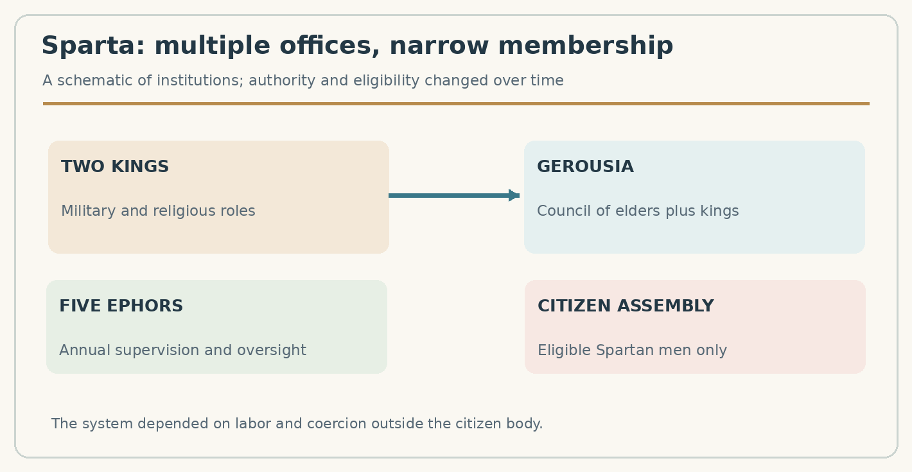

Спарта традиционно имаше двама царе от отделни кралски къщи, свързани особено с командването във война и религиозни задължения. Но царете не управлявали сами. Съветът на старейшините, герусата, включваше по-възрастни мъже и царе; пет избрани ефори упражняваха важни надзорни правомощия; и събрание от отговарящи на условията мъже биха могли да участват в публични решения, въпреки че неговата власт и процедури бяха по-ограничени, отколкото в демократична Атина. Точният баланс се променя във времето и е реконструиран от източници, написани при различни обстоятелства.

В Спарта официалната стабилност се основаваше на множество офиси и обичайни очаквания, а не на просто съвременно конституционно разделение на силите. Двамата крале можели да се проверяват един друг, но също така и да се конкурират. Ефорите могат да държат лидерите отговорни, но малката гражданска структура и зависимостта от хелитния труд ограничиха по-широката легитимност на системата. Една държава може да съдържа вътрешни проверки, без да е демократична в съвременния или атинския смисъл.

По-нататъшно усложнение е колко нашата снимка идва от външни хора. Ксенофон се възхищавал на много спартански практики; Аристотел критикувал части от своите институции; Плутарх, пишещ векове по-късно, запазил истории за легендарния законодател Ликургъс. Археологията и надписите предоставят допълнителни доказателства, но някои познати детайли от спартанското възпитание или закони остават спорни. Вместо да запомни перфектно фиксираната "Спартанска конституция," внимателният читател пита кой период и кой източник на претенции се отнася до нея.

<figure class="figure" id="figure-16-3">

<figcaption>Фигура 16.3. Спартанските власти бяха разделени между множество институции, но пълното политическо гражданство беше тясно. <a class="figure-anchor" href="#figure-16-3" aria-label="Link to this figure">#</a></figcaption>
</figure>
