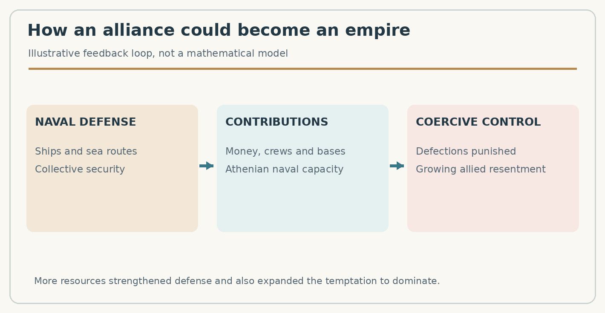

След Персийските войни една лига от гръцки общности, водена от координирани военноморски действия в Атина и събирането на дарения. Съкровищницата му първоначално била свързана със свещения остров Делос, което породило името Делийската лига. Членовете доставяха кораби или пари, в договорености, които се промениха с течение на времето. За градове, уязвими към персийска атака, колективната защита има очевидни предимства. За Атина лигата увеличи корабите, финансовите ресурси и политическата власт.

С течение на времето Атина става все по-склонна да използва сила, за да предотврати съюзническите дезертьори и да наложи вноски. Някои съюзници имали "защита" като господство. Прехвърлянето на хазната на лигата в Атина през 454 г. пр.н.е. символизира и улеснява променящите се отношения, въпреки че се обсъждат точните мотиви и механизми. Израстването на империя от съюз не е просто морално противоречие, а проблем със системите. Военноморската власт се нуждае от стабилно финансиране и бази за защита на морските маршрути; актът за осигуряване на тези ресурси може да направи неохотните партньори зависими и ядосани.

Ето защо гръцката история показва неприятно съжителство: същият град, който пионерствал в извънредното гражданско участие у дома, принудил подчинението в чужбина. Един гражданин моряк може да види заплатите и гражданската си власт, подкрепени от военноморски приходи, докато съюзническа общност вижда данъци, принудително политическо изравняване или наказание за съпротива. Ако човек хвали демокрацията, без да изследва империята, той пропуска една основна черта на атинянското преживяване.

<figure class="figure" id="figure-16-8">

<figcaption>Фигура 16.8. Съюзническите вноски засилиха флотата, като същевременно създадоха и капацитет за принуда. <a class="figure-anchor" href="#figure-16-8" aria-label="Link to this figure">#</a></figcaption>
</figure>
