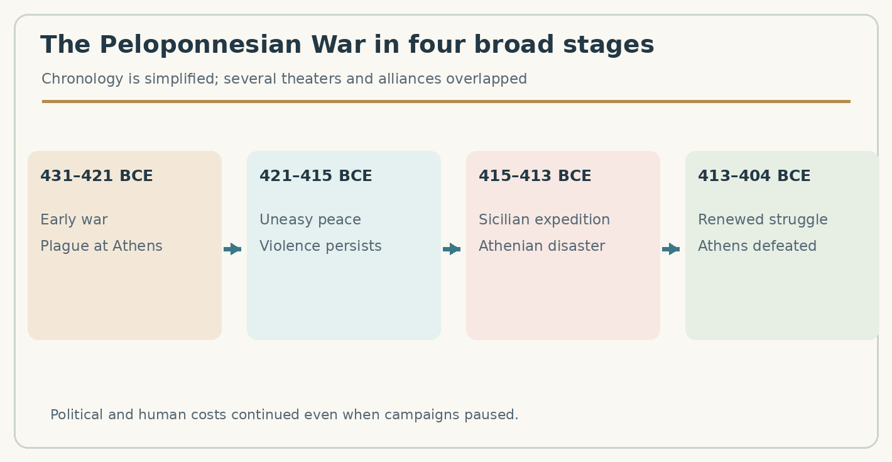

Пелопонеската война традиционно течеше от 431 до 404 г. пр.н.е., като фазите на откритите боеве бяха прекъснати от крехки мирове и обновени кампании. Атина ръководи морска империя и командва страховита флота; Спарта е доминираща сухоземна сила с мрежа от съюзници, често наричана Пелопонеска лига. Thucydides известно подчертава страх, причинени от нарастващата сила на Атина като основен източник на конфликта, но конкретни спорове, свързани с Corcyra, Коринт и Potidaea също са от значение. Не трябва да бъркаме нито едно елегантно обяснение за единствената причина.

В началото на войната атиняните възприеха стратегия, свързана с Перикъл: избягвайте да се изправяте срещу по-висшите спартански сухопътни сили в решителна битка, приютете хората в стените и разчитайте на морска сила и внос. Стратегията защитава военната сила, но пренаселва града. Опустошителна епидемия порази Атина, започвайки през 430 г. пр.н.е., убивайки много жители и самия Перикъл през 429 г. Нейната точна самоличност на болестта остава дискутирана. Епидемията беше бедствие на общественото здраве в една продължаваща война; нито морално наказание, нито заговор, изискван от доказателствата.

Конфликтът засегна фермерите, чиито полета бяха разрушени, поробени хора, чиито животи вече бяха несигурни, съюзници принудени да изпращат ресурси, войници и семейства, изправени пред смърт и изселване. Историите изградени около битки могат да заличат това бавно унищожение на общностите. Войната също промени политическите стимули: лидерите биха могли да спечелят аплодисменти за агресивни обещания, фракции обвиняват съперниците си в нелоялност и продължителната несигурност затруднява умерения компромис. Рамката на системите на главата ни помага да видим ескалиращо недоверие, без да се преструваме, че всеки актьор е еднакво отговорен за всяко решение.

<figure class="figure" id="figure-16-9">

<figcaption>Фигура 16.9. Пелопонеската война включваше променящи се фази и повтарящи се политически смущения. <a class="figure-anchor" href="#figure-16-9" aria-label="Link to this figure">#</a></figcaption>
</figure>
