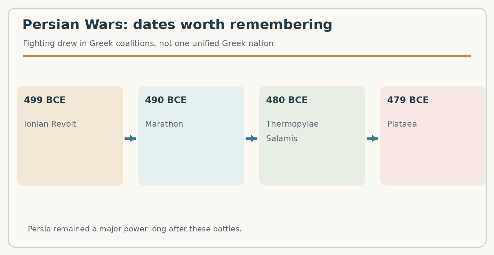

Историята за Персия и гръцките градове се свързва директно с Глава 15. Някои гръцки общности в Западна Анадола живеели в Империята на Ахеменитед. Йонийският бунт започва през 499 г. пр.н.е., привличайки персийски отговори и ограничена континентална гръцка намеса. През 490 г. пр.н.е. една атинянска сила, с помощта на Платая, победила персийска експедиция в Маратон. През 480 BCE Xerxes доведе много по-голяма инвазия; известни битки, включени Термопили и военноморски ангажимент в Саламин. Коалиция от гръцки сили победи големи персийски сили в Платая през 479 г. пр.н.е.

Тези събития бяха важни, но общата история за "единни гърци, защитаващи свободата от поробена Персия" е подвеждаща. Множество гръцки общности останаха неутрални, присъединиха се към персийската страна или взеха решения под натиск. Гръцкият полюс не е бил съгласен помежду си преди, по време и след инвазията. Персийската империя издържала дълго след това; Гърция не станала една свободна и хармонична нация. Битките бяха част от по-широка имперска и Егейска история, а не нито един решаващ конкурс между съвременните политически идеологии.

Какво направи сътрудничеството възможно въпреки съперничеството? Незабавните военни заплахи могат да променят стимулите. Гръцките общности могат да обединят сили, като запазят отделни правителства. Военната сила на Спарта и военноморските сили на Атина допринесоха по различен начин. Подкрепата на Темистокъл за атинянската военноморска сила е важна част от историята, въпреки че по-късно авторите оформят образа на този лидер по различен начин. Географията е от значение за стратегията, пристанищата и линиите за доставка, но няма географски характеристики, които да предопределят резултата.

<figure class="figure" id="figure-16-7">

<figcaption>Фигура 16.7. Основни военни котви на персийските войни; Гръцките съюзи не бяха политическо обединение. <a class="figure-anchor" href="#figure-16-7" aria-label="Link to this figure">#</a></figcaption>
</figure>
