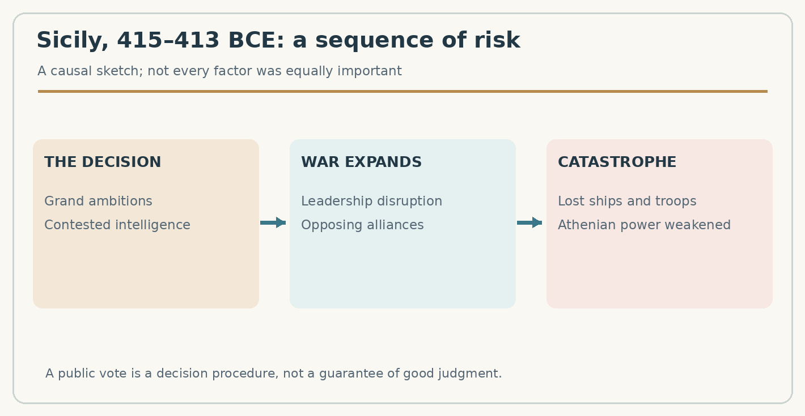

Върнете се на дебата от откриването. През 415 BCE Атина започна голяма експедиция до Сицилия, частично свързани с съперничество, включващи Segesta и Syracuse и частично оформени от по-широки надежди за увеличаване на властта. Експедицията беше спорна. Thucydides представя Nicias предупреждение за ангажимента и Alcibiades, които твърдят за него, но ние трябва да третираме изказванията като реконструирани аргументи, а не пълни преписи.

Операцията е нараснала далеч отвъд ограничена намеса. Политически скандал у дома засегна лидерството; Alcibiades дезертира, след като беше отзован да се изправи пред обвинения. В Сицилия Атина среща сериозни логистични, дипломатически и тактически трудности. Сиракуза получи подкрепа от Спарта и други опоненти. Атинянското подкрепление не спаси ситуацията. До 413 г. пр.н.е. експедицията е приключила с унищожаването или залавянето на голяма част от силите, скъп удар върху военноморските и човешките ресурси на Атина.

Защо едно събрание, способно на енергични разисквания, доведе до такъв катастрофален резултат? Въпросът няма нито един отговор. Надежда за разширяване, самоувереност, неадекватно познаване на местните условия, желанието да не изглеждаме слаби, стратегически съперници и изместване на лидерството всички допринесоха. Решението може да бъде взето демократично и все още е лошо информирано. Правилният исторически урок не е, че масовото участие винаги се проваля; неизбраният владетел може да направи същата грешка. Урокът е, че процедурите за вземане на решения и качеството на решенията са различни измерения. Оценката на риска, достъпът до несъгласие и възможността за преразглеждане на плановете имат значение във всеки режим.

<figure class="figure" id="figure-16-10">

<figcaption>Фигура 16.10. Схема на решения и последствия, а не пълно обяснение на поражението. <a class="figure-anchor" href="#figure-16-10" aria-label="Link to this figure">#</a></figcaption>
</figure>
