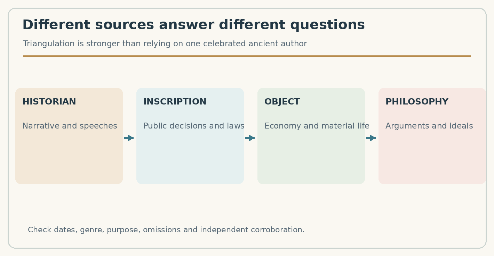

Как можем да възстановим спорното решение на Атинянина? Да предположим, че един студент твърди: "Събитието винаги слушаше и двете страни и затова вземаше рационални решения." Първо разгледайте сметка, като например сицилианското разискване на Thucydides. Той показва конкурентни аргументи, но историкът композирал изказванията и избрал епизода. Второ, помислете за надпис или указ, който записва официално решение. Това може да установи аспекти от това, което е било прието, но може да не разкрие всички обсъждания, посещения или мотиви. Трето изследване на археологията: кораби, пристанищни инфраструктури, военни гробове, монети и други материали могат да разкрият ресурси и последствия, но това не може да докаже личните вярвания на оратора.

Сега обърнете твърдението: "Атинянската демокрация не е нищо друго освен мафиотско управление." Това също надвишава доказателствата. Атиняните разработиха структурирани конгреси, съвети, процедури за отчетност, публично заплащане за услуги и големи граждански журита. Имаме примери както за разумни, така и за разрушителни решения. Историкът трябва да провери твърденията едно по едно, да разграничи процедурите от резултатите и да уточни времето, което се изучава. Самите атиняни спорели дали многото или малцината били най - способни да управляват.

Всеки източник разказва различна част от историята. Гравираният закон може да покаже официален принцип, без да доказва съответствие. Комедията може да улови тревоги, докато преувеличава личностите. Враждебната олигархична брошура може да разкрие елитни страхове дори когато атаките й са несправедливи. Философският диалог може да осветли въпросите от възрастта на автора му, без точно да описва истинския разговор. Критиката на източника не е ритуал да се казва "всичко е предубедено." Това е дисциплина, която прави най-силния защитен извод от всеки вид оцелели доказателства.

<figure class="figure" id="figure-16-11">

<figcaption>Фигура 16.11. Историците сравняват литературните разкази, официалните записи, предметите и философските аргументи. <a class="figure-anchor" href="#figure-16-11" aria-label="Link to this figure">#</a></figcaption>
</figure>
