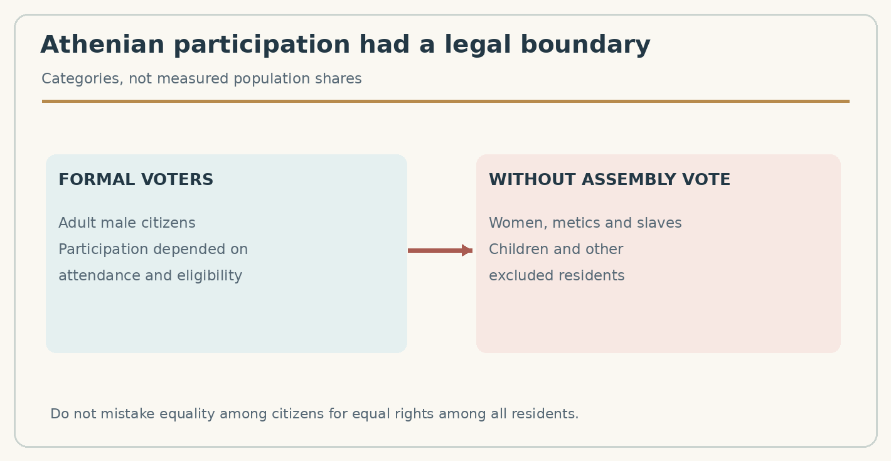

Фразата "Атинс изобрети демокрацията" изисква присъда за квалификация. Участието в управителните институции беше ограничено главно до възрастни мъжки граждани. Жените от граждански семейства не са гласували в Асамблеята или не са служили в големите политически служби на демокрацията. Жителите чужденци, често наричани метик в класическия контекст, работили, търгували, плащали данъци и понякога изпълнявали военни задължения, но обикновено не се радвали на граждански права на глас. Поробените хора нямат политическа свобода, сравнима с тази на гражданите. Децата също бяха изключени от големите политически институции.

Правилата за гражданство могат да станат по-ограничителни. Закон за гражданството на Перикъл от 451/450 г. пр.н.е., който често се разбира, че изисква двама родители граждани за пълен граждански статут, е пример за политическа общност, която стеснява членството, като същевременно увеличава силата на тези вътре в него. Прогнозите за съотношението между гражданите и общото население на Атика варират рязко, тъй като доказателствата са непълни и категориите се променят с течение на времето. Диаграма, която твърди, че точният дял от всички жители е гласоподаватели, означава фалшива сигурност. Това, което е сигурно, е, че политическата група за възрастни мъже е била малцинство от по-голямото население.

Противоречието има значение. Атина разработи механизми за гражданско равенство в рамките на гражданската група, като в същото време почива на икономически и социални отношения извън нея. За да се поучите от институционалните постижения, без да романтизирате изключванията, задайте два въпроса поотделно: колко власт е имал гражданин, който отговаря на условията, в сравнение с гражданите другаде, и на кого е било отказано това право? Разграничаването е от съществено значение за сравняване на древната демокрация със съвременните конституционни системи, където широкото пълнолетно право и индивидуалните права са основни стремежи.

<figure class="figure" id="figure-16-6">

<figcaption>Фигура 16.6. Политическата сила на мъжете граждани съжителстваше с изключването на много жители. <a class="figure-anchor" href="#figure-16-6" aria-label="Link to this figure">#</a></figcaption>
</figure>
