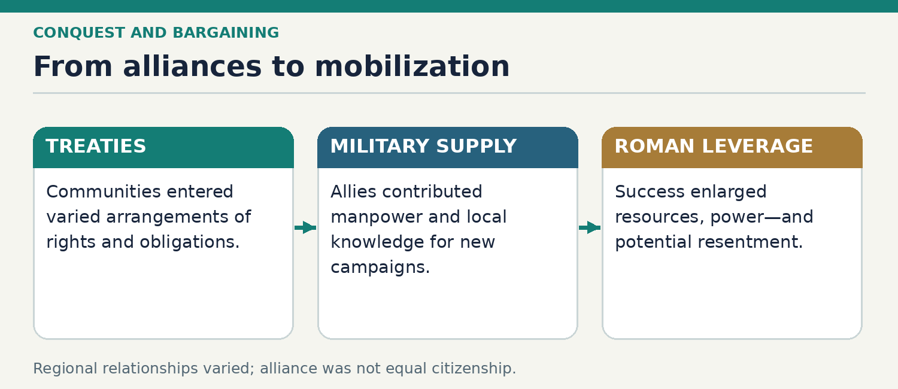

Рим не завладял цяла Италия в една кампания. Нейните войни срещу латинските съседи, етруските общности, Самнитите и гръцките градове се простирали през поколенията. Осквернени или съюзнически общности влязоха в различни договорености: някои придобиха гражданство, други частични права, други договори, изискващи военна помощ. Пътищата, колониите и укрепленията помогнали за проекта на римската сила. В резултат на това мрежата можела да мобилизира хора в мащаб, който дал на Рим забележителен капацитет за възстановяване от военни поражения.

Тази система комбинира стимули и принуда. Съюзническа общност може да се възползва от римската подкрепа и достъп до мрежи, като същевременно губи свободата си във външната политика и допринася за войните, които не е избрала. Римските колонии могат да осигурят територия и да заселят гражданите, но също така са засегнали предишните жители. Гражданството се превърна в мощен инструмент за интеграция именно защото беше желателно и неравномерно разпространено.

В 280млн. пр. Хр., Пирхус от Епирус, провежда кампания в Италия в подкрепа на гръцките градове. Той спечели битки на тежки разходи, но не установи трайно превъзходство. Неговите войни разкриват пристигането на Рим като голяма италианската сила и връзката между италианските конфликти и елинистичните кралства, създадени след Александър. Изразът "Пирическа победа" улавя разликата между спечелването на битка и постигането на устойчива политическа цел. Най-голямото военно предимство на Рим може да е било мрежата му от съюзници, нито едно оръжие или непобедим генерал.

<figure class="figure" id="figure-17-3">

<figcaption>Фигура 17.3. Договорите и военните задължения създават мрежа, способна на изключителна мобилизация. <a class="figure-anchor" href="#figure-17-3" aria-label="Link to this figure">#</a></figcaption>
</figure>
