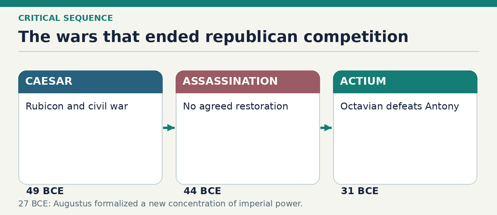

Кариерата на Юлий Цезар показва колко е трудно да се отдели законната служба от изключителната власт. През 60 г. пр.н.е. той влязъл в неформален политически съюз с Помпей и Крас, по-късно известен като Първия Триумвират. Това не беше конституционен тричленен изпълнителен директор. Впоследствие Цезар командвал големи кампании в Галия, чието завоевание разширило римската власт и причинило голяма смърт, поробване и преместване. Неговият собствен разказ за кампаниите е важен, но егоистичен източник; победите, разказани от победния командир, изискват независим контрол.

Конфликтът с Помпей и други политически съперници накарали Цезар да прекоси Рубикон с войски през 49 г. пр.н.е., започвайки друга гражданска война. След победата той натрупа изключителни офиси и почести, кулминация в диктатурата на живота. През март 44 г. пр.н.е. група сенатори го убиха. Конспираторите говорели езика на свободата, но все още нямали широко приет план за уреждане на претенциите на армията на Цезар, неговите поддръжници и по-широкото гражданско тяло. Убийството на лидер не е унищожило системата от стимули, която го е създала.

Наследникът на Цезар Октавиан, по-късно Август, се съюзил с Марк Антоний и Лепид в законно установен втори Триумвират през 43 г. пр.н.е. Последваха рецепти и гражданска война. След поражението на убийците на Цезар във Филипи през 42 г. пр.н.е. Октавиан и Антоний в крайна сметка станали съперници. Сдружението на Антоний с Клеопатра VII, царицата на Египет, било основен компонент на политическия конкурс, но римската пропаганда го превърнала в история за чуждо влияние и римски морал. Октавиан побеждава силите си в Акциум през 31 г. пр.н.е. Антоний и Клеопатра умрели през 30 г. пр.н.е., а Египет бил под римско управление. Републиката оцеля с думи и церемонии, но един човек сега контролира решителните армии.

<figure class="figure" id="figure-17-7">

<figcaption>Фигура 17.7. Републиканските граждански войни завършват с правилото на един човек, маскирано през традиционните офиси. <a class="figure-anchor" href="#figure-17-7" aria-label="Link to this figure">#</a></figcaption>
</figure>
