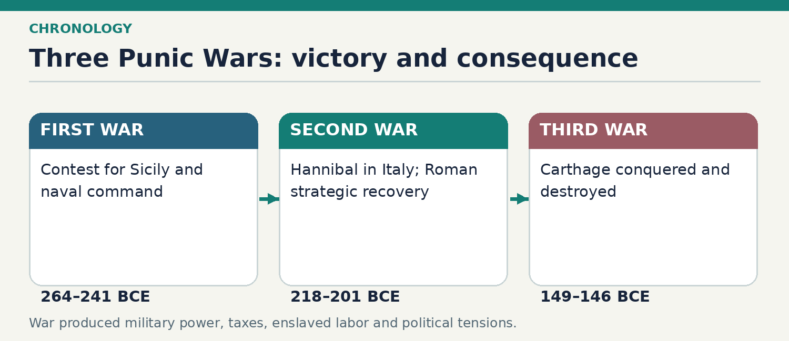

Картаген, основан от заселници от финикийския свят в Северна Африка, се превръща в сложна морска и търговска сила с интереси в западното Средиземноморие. Съперничеството му с Рим се превърнало в три големи войни. В Първата Пуническа война (264 и 241 г. пр.н.е.), основната борба, съсредоточена върху Сицилия; Рим развива военноморските способности, необходими за оспорване на голям морски съперник. Втората пуническа война (218.201 BCE) видял Ханибал да води армия от Иберия над Алпите и да нанася опустошителни поражения върху римските армии в Италия, особено в Канае през 216 г. пр.н.е. Римската съпротива и кампании отвъд Италия помогнаха за обръщането на стратегическата позиция. Сципион победил Ханибал при Зама през 202 г. пр.н.е.

От решаващо значение е, че зрелищният успех на бойното поле не се превръща непременно в политическа победа. Ханибал може да унищожи римските армии, без да убеди достатъчно италиански съюзници да изоставят римските си връзки. Рим може да поеме загубите чрез институции, хора и съюзнически ангажименти, които са оцелели след бедствие. И двете държави разчитаха на различни народи и ресурси; намаляването на войната до двама героични командири замъглява тази по-голяма картина.

Третата пуническа война (146/BCE) завърши с римските сили, унищожаващи Картаген като съперничен политически център. Съвременните митове понякога описват Рим, който постоянно осолява почвата си. Историците не смятат това за установена древна практика. Завоеванието включвало огромни човешки страдания и поробване. Рим се появил като ненадмината западна средиземноморска сила, но неговите външни победи засилили вътрешните спорове за богатство, военен труд и разпределение на завладени ресурси. Успехът на Републиката промени средата, в която действат републиканските политически правила.

<figure class="figure" id="figure-17-5">

<figcaption>Фигура 17.5. Трите пунически войни променили средиземноморската власт и засилили римското политическо напрежение. <a class="figure-anchor" href="#figure-17-5" aria-label="Link to this figure">#</a></figcaption>
</figure>
