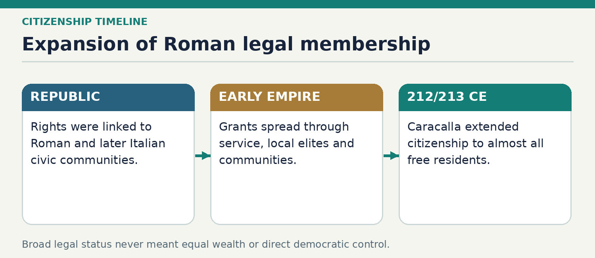

Римското гражданство започнало като привилегирована правна и политическа принадлежност, съсредоточена върху Рим, след което се разпространила на различни етапи. Социалната война (91.88 BCE) е водена отчасти от исканията на италианските съюзници за гражданство и равно третиране в рамките на държава, която те са помогнали да се защитят. Рим в крайна сметка разшири гражданството в голяма част от Италия. По-късно предоставя признати услуги, елитен статут, местни общности и имперски решения. До втори век CE гражданинът бил разпръснат из провинциите.

През 212 или началото на 213 CE, император Каракала издава Конституцио Антонина, като цяло разбира да предостави римско гражданство на всички или почти всички свободни жители на империята, които вече не са имали. Оцелелият папирус е повреден и се обсъждат конкретни изключения и мотиви. Гражданството не е премахнало робството, бедността, неравенството или географското разделение. Нито пък всички изведнъж говореха латински или приемаха еднакви обичаи. Променило се е в правния статут на забележителни общества.

Този случай предлага важна разлика между законно членство и реално влияние. Един провинциален жител може да стане римски гражданин, без да получи ефективен глас при избора на император. От друга страна, влиятелен местен служител без гражданство в по - ранния период може да упражнява значителна практическа власт. Когато съвременните политически аргументи призовават "римско гражданство," попитайте: кой век, кои права и за кого?

<figure class="figure" id="figure-17-10">

<figcaption>Фигура 17.10. Римското гражданство се разширява на етапи, като завършва в Каракала (Caracalla) с широка субсидия за свободните жители. <a class="figure-anchor" href="#figure-17-10" aria-label="Link to this figure">#</a></figcaption>
</figure>
