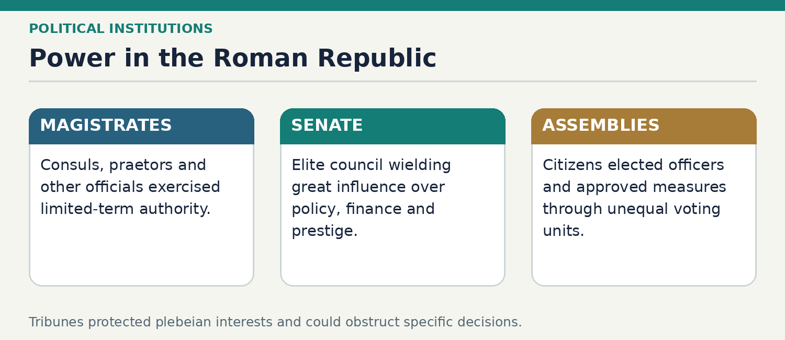

Сенатът е бил силен съвещателен съвет, а не модерен избор на горната къща. Членството му идва до голяма степен от мъже, които са имали магистратура. Той контролираше голяма част от външната политика, финансите и политическите съвети, упражнявайки огромно обичайно влияние дори когато официалните му резолюции не бяха равностойни на устава във всяка обстановка. Консулите водеха армии и ръководеха централните дела. Праеторите са играли важна роля в правната администрация. Квесторите се справиха с финансовите отговорности, докато цензурите, избирани периодично, оценяват списъка на гражданите и наблюдават някои аспекти на обществения статут и поведение.

Популярните конгреси избраха магистрати и гласуваха за законодателство, но римското гласуване не беше едно лице, а един равен глас. Събрания групират гражданите по столетия или племена, а тежестта и редът на гласуване биха могли да се възползват от по-богатите граждани. Срещите бяха свикани и натопени от служители. Гражданите биха могли да изразят съгласие или отхвърляне, но обикновено не са изготвяли закони чрез постоянен обсъждащ парламент. Пътните разходи и разстоянието правят физическото участие по-трудно, тъй като гражданското тяло се разширява в цяла Италия.

Затова политическата система смесва аристократичното ръководство, популярното вземане на решения, правната традиция и военното командване. Някои римляни празнували този баланс като източник на стабилност. Гръцкият историк Полибиус, който писал през втори век пр.н.е., известен като анализ на римските институции чрез рамка от смесено правителство. Разказът му е светъл, но той също отразява гледната точка на един наблюдател, впечатлен от римския успех. Трябва да се запитаме дали институциите, които са работили в град на регионалните елити, могат да управляват държава, простираща се в Средиземно море.

<figure class="figure" id="figure-17-2">

<figcaption>Фигура 17.2. Републиканската власт включваше магистрати, Сената, конгреси и трибуни; никоя институция не се управляваше сама. <a class="figure-anchor" href="#figure-17-2" aria-label="Link to this figure">#</a></figcaption>
</figure>
