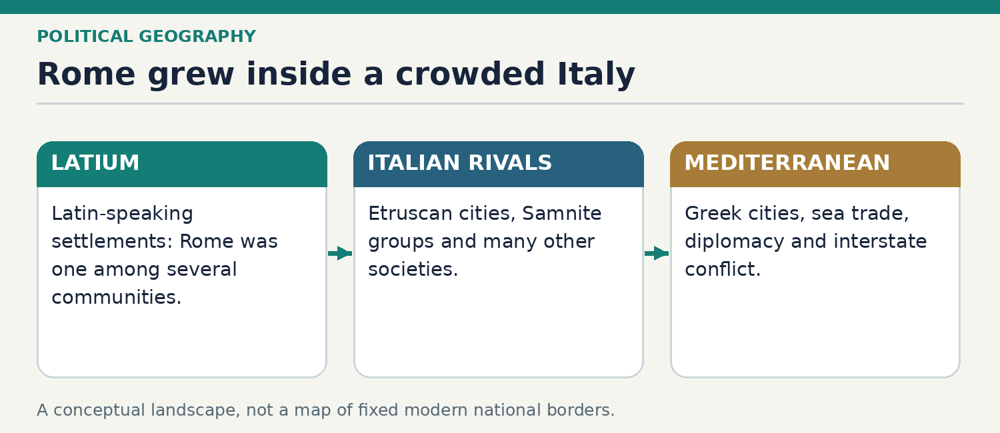

Рим стои до река Тибър в Централна Западна Италия, а не в сърцето на естествено обединен полуостров. Планините Апенин се спускат по Италия; крайбрежните равнини и долини свързват селищата; а Средиземно море прави пътуването и размяната възможна. През първото хилядолетие пр.н.е. полуостровът бил дом на много народи с различни езици и политически традиции. Етруските построили богати градски центрове в Централна Италия. Гръцките говорещи общности процъфтявали в южна Италия и Сицилия. Самонитски говорещи групи доминирали части от централните и южните планини. Латинскоговорящите селища се струпват около Латий, района на Рим.

Рим растеше сред тези контакти. Неговите религиозни ритуали, архитектура, материална култура и политически практики не са възникнали в изолация. Етруските и гръцките влияния са видими в археологията, а по-късно и римските традиции, въпреки че често е трудно да се докажат отделни истории за заемане на заеми. Местоположението на града го е превърнало в една прекосяване на реката и регионален пазар сред мнозина, преди да стане център на забележителна политическа система. Когато по - късно римляните описали себе си като предопределени да управляват света, те чели един необикновен резултат назад в много по - малко сигурно начало.

Една карта може да се заблуди, ако започне с империята оцветена в червено и третира всяка провинция като неизбежно римско притежание. За да разберем как е нараснал Рим, трябва да започнем с претъпкан пейзаж от съперници, съюзници, мигранти и търговски партньори, всеки със собствен политически избор. Местният конфликт, адаптацията и договорените взаимоотношения са от значение колкото географията.

<figure class="figure" id="figure-17-1">

<figcaption>Фигура 17.1. Рим се появява сред множество италиански общности и средиземноморски връзки. <a class="figure-anchor" href="#figure-17-1" aria-label="Link to this figure">#</a></figcaption>
</figure>
