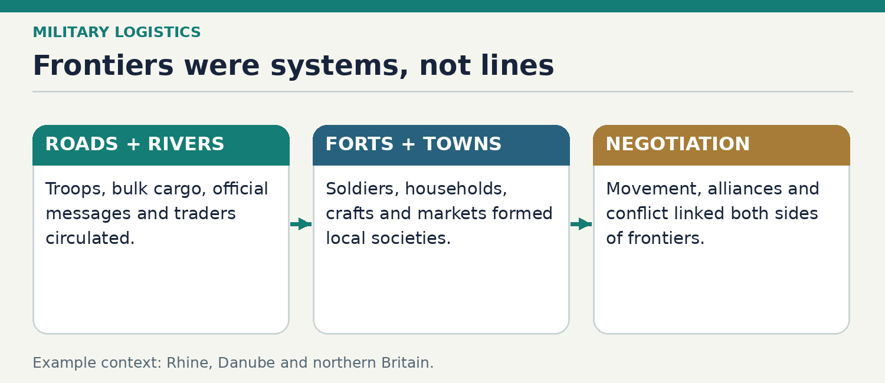

В най-голямата си териториална степен под властта на Траян в началото на втори век, римската сила достига от Великобритания до части от Месопотамия и от Рейн и Дунав до Северна Африка и Египет. Точните граници се изместиха и не винаги бяха солидна, непрекъсната стена. Границите могат да бъдат укрепени, патрулирани, договорени и пресичани. Трейдъри, войници, дипломати, семейства и рейдъри преминаха през тях. Адриановата стена в Северна Великобритания е известен физически пример за управление на границите, а не доказателство, че римските и неримските общества са били запечатани един от друг.

Римските пътища пренасяли войски, послания, данъци и стоки. Инженерите построили трайни павирани маршрути в много области, но реките и морските алеи често придвижвали насипните стоки по-ефективно. Портове, пристанища, складове, мостове и речни флоти са от съществено значение. Римски чиновник в Дунавските провинции може да зависи от системата за пресичане на сухопътните пътища, речния транспорт, военните постове и местните доставчици. Държавата може да проектира сила, защото тя може да движи и храни хората, а не само защото картата е голяма.

Армията също беше общност. Войниците служат далеч от родното си място; помощните части, наети от провинциите, и ветераните може да се установят близо до бивши постове. Археологически обекти като Виндоланда във Великобритания запазват писма и списъци, които разкриват храна, облекло, домашни взаимоотношения и обикновени грижи заедно с военните заповеди. Такива доказателства усложняват познатия образ на анонимни легиони, маршируващи в перфектна формация. Границата беше социален пейзаж, а не само защитна линия.

<figure class="figure" id="figure-17-8">

<figcaption>Фигура 17.8. Римските гранични региони са интегрирани пътища, реки, крепости, местни пазари и трансгранично движение. <a class="figure-anchor" href="#figure-17-8" aria-label="Link to this figure">#</a></figcaption>
</figure>
