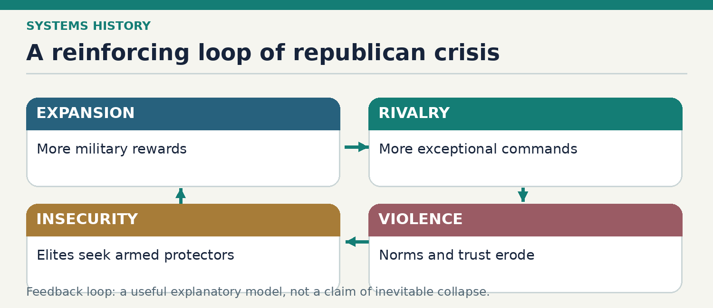

Римските армии се променили през вековете; една подредена "Марианска реформа," която мигновено създала професионални легиони, е свръхопростяване. И все пак политическата динамика безспорно се изместила като командири култивирали лоялност чрез възможности за плячка, заплащане, земя и напредък. Военните победи дават на хората репутация и ресурси, които биха могли да надвият обикновените институционални ограничения. Взаимоотношенията между войници, командири, разпределение на земи и политическа служба стават все по-опасни.

През 88 г. пр.н.е. Сула марширува своята армия в Рим на фона на конфликт над командването, пресичайки норма от изключителна важност. След гражданска война той наложи диктатура и политически предписания, в които враговете са били насочени и имущество конфискувани. Той твърдеше, че ще възстанови Републиката докато използва принудителна лична сила, за да я промени. Прецедентът е от значение дори и след пенсионирането на Сула: въоръженото превземане на столицата се е превърнало в политическа възможност.

Не бива да се казва, че Републиката "скъса, защото демокрацията отиде твърде далеч" или защото един амбициозен генерал искаше власт. Социална конкуренция, завоевание, институционален дизайн, неравнопоставено богатство, политическо насилие, стимулите на армейските команди и неуспехите на елитния компромис се засилваха взаимно. Всяка криза прави следващата по-трудна за решаване. Това е исторически кръг за обратна връзка: гражданският конфликт увеличава страха; страхът оправдава извънредните команди; изключителните команди отслабват обикновените правила; отслабените правила увеличават привличането на въоръжена защита.

<figure class="figure" id="figure-17-6">

<figcaption>Фигура 17.6. Укрепването на механизмите между завоевание, командване, конкуренция и насилие отслаби републиканската сдържаност. <a class="figure-anchor" href="#figure-17-6" aria-label="Link to this figure">#</a></figcaption>
</figure>
