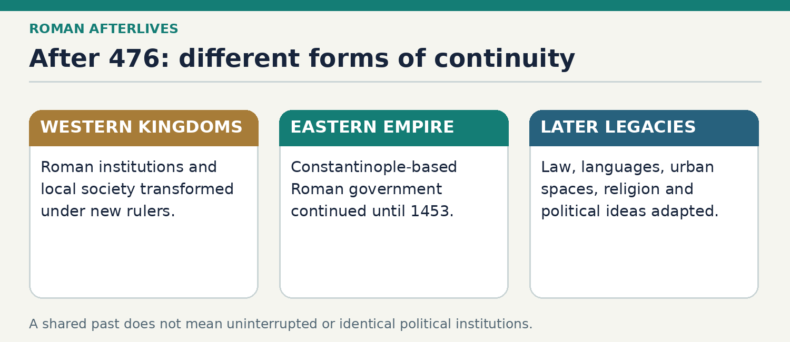

Източното римско правителство, базирано в Константинопол, преживяло политическите промени от пети век на Запад. Съвременните историци често наричат по - късната си история византийска, но нейните владетели и много поданици се считат за римляни. С течение на времето гръцкият език стана доминиращ административен език, докато политическите, правните и религиозните институции се промениха драматично. Под Юстиниан I през шести век източните армии възстановили някои бивши западни територии, а императорските юристи създали Корпус Юрис Цивилис - основна компилация и организация на римските правни традиции.

Източната империя се сблъскала с по-късни войни с Персия, Арабско-мюсюлманските завоевания, вътрешни борби, религиозни спорове и нови регионални сили. Границите му са договорени и понякога се възстановяват. Той остава важен актьор в историята на Източното Средиземноморие и Балканите от векове. Константинопол е паднал от османските сили през 1453 г., дата с огромни последици, но не и причина за изравняване на предходните хиляда години в едно непроменящо се "римско оцеляване." Източната римска история заслужава отделна глава от по-големия разказ.

Западните пост-римски владетели, средновековното папство и по-късно европейските правителства също твърдели, адаптирали или тълкували отново римската власт. Средновековни адвокати изучавали римски текстове; латински и романтични езици носели римска езикова легитимация; пътища и градски обекти, оформящи по - късното селище. Но влиянието не е доказателство за непрекъсната институционална приемственост. Римският Сенат, средновековната Свещена Римска империя, съвременните парламенти и съвременните системи за гражданство са исторически различни дори когато техните участници заемат речник и символи от древността.

<figure class="figure" id="figure-17-12">

<figcaption>Фигура 17.12. Западният императорски двор приключил, но продължило източното римско правителство и множество римски наследства. <a class="figure-anchor" href="#figure-17-12" aria-label="Link to this figure">#</a></figcaption>
</figure>
