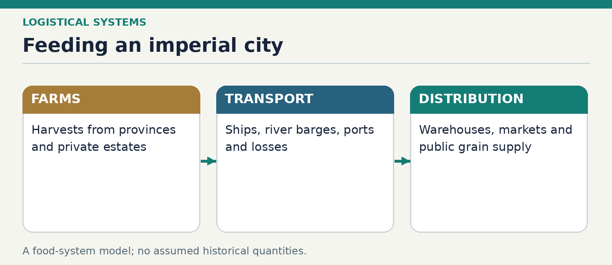

Икономиката на Рим смесва производството на домакинствата, селското стопанство, частния обмен, държавната реквизиция, данъчното облагане, обществената сграда, военните разходи и формите на принудителен труд. Мащабът на средиземноморската търговия бил забележителен, но империята нямала индустриална икономика, съвременни национални сметки или единен свободен пазар. Местните цени, транспортните разходи, трудовите отношения и правата на собственост варираха. Някои градове били богати търговски центрове; много хора останали свързани с производството на селските райони.

Римският град зависел от огромни хранителни мрежи. Зърното от Африка, Сицилия и Египет доставя капитала, като участието на анона на държавата в предлагането и разпространението на зърно става политически значимо. Лошата реколта или прекъснатият транспортен маршрут биха могли да имат последствия далеч извън селските райони. Морският транспорт често е бил по-евтин за насипни храни, отколкото да го мести на големи разстояния. Акведуктите, баните и улиците символизират градския живот, но складовете, пристанищата и данъчните регистри могат да ни кажат повече за това как са оцелели тези градове.

Да разгледаме едно измислено упражнение: градът се нуждае от 600 тона зърно всеки месец. Ако 20 процента са загубени по време на транспортиране и съхранение, колко трябва да бъдат доставени? Разделете 600 на 0.8: 750 тона. Тази аритметика не е оценка на римски исторически пратки; тя показва система проблем. Администраторите трябваше да отчитат загубите, променливите сезони и транспортния капацитет. Политическата власт отчасти беше способността да се справят с такива проблеми. Това беше и способността да се реши кой ще поеме разходите за управлението им.

<figure class="figure" id="figure-17-9">

<figcaption>Фигура 17.9. Зърното свързва далечните земеделски провинции с императорските градове и политическата власт. <a class="figure-anchor" href="#figure-17-9" aria-label="Link to this figure">#</a></figcaption>
</figure>
