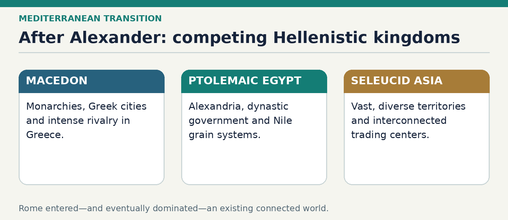

Глава 16 описва гръцката поляна, но техният свят не просто изчезва след като Атина и Спарта се бият. Филип II от Македон победи коалиция гръцки държави в Херонея през 338 г. пр.н.е. Синът му Александър завладял Персийската империя Ахеманид, преди да умре във Вавилон през 323 г. пр.н.е. Наследниците на Ревал се наричат Диадочи, които се състезават в елинистични династии в Египет, Македон и Западна Азия. Градове като Александрия станаха центрове на стипендия, търговия и кралски показ. Гръцкият език и културни практики се разпространяват заедно с египетските, иранските, месопотамските и други традиции, създавайки нови комбинации, а не просто заместител на местните култури.

Рим влезе в този свят като Италианска република първоначално по-малко престижна от великите монархии. През втори и първи век пр.н.е. той победи македонските армии, намеси се в гръцките дела и преобрази отношенията си с елинистичните кралства. Той унищожи Коринт през 146 г. пр.н.е. и разшири властта си в Гърция, но управляващият елит с нетърпение събра гръцко изкуство, изучаваше гръцката философия и наемаше гръцки учители. Рим може да завладее политиката, докато абсорбира културата.

Последният Птолемейски владетел на Египет, Клеопатра VII, управлява царство, вкоренено в този елинистичен свят. Нейният конфликт и съюз с римските водачи принадлежали към по-дълга борба над източното Средиземноморие, а не просто една романтична подпартида. Традиционният елинистичен период завършва около 31/30 г. пр.н.е. с Актиум и края на независимото птолемейско управление; културните и интелектуалните традиции продължават отвъд този политически маркер. По този начин историята на Рим е и история за това колко по-стари цивилизации са били реорганизирани в новия имперски ред.

<figure class="figure" id="figure-17-4">

<figcaption>Фигура 17.4. След Александър, наследниците на царствата доставяли политическия и културен свят, в който Рим се разширявал. <a class="figure-anchor" href="#figure-17-4" aria-label="Link to this figure">#</a></figcaption>
</figure>
