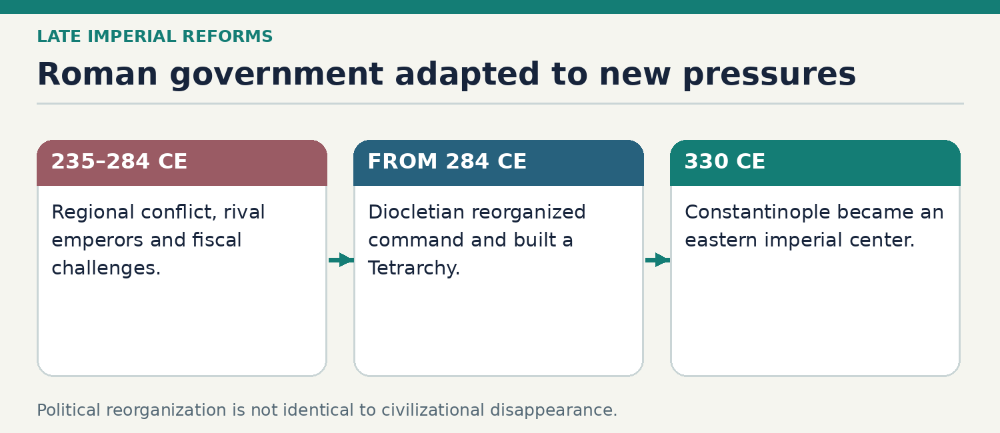

През по - голямата част от третия век от н.е. императорите били изправени пред военни бунтове, съперници ищци, гранични атаки, фискални предизвикателства и смущения в монетите и администрацията. Историците се позовават на криза на Трети век, особено на периода от 284 г. до н.е. Но "криза" не трябва да означава, че всяка провинция е претърпяла еднакъв икономически колапс. Доказателствата варират значително между регионите; градското строителство, търговията и местния живот са следвали различни пътища.

Диоклециан, който дошъл на власт през 284 г., реорганизирал императорската администрация и правителство. Неговата Tetrarchy възложени власт на двама старши императори и двама младши колеги в опит да управлява военни заплахи и наследяване през огромна територия. Това беше изобретателен отговор на системните трудности, но съперничеството продължаваше. Константин в крайна сметка консолидирал едноличното управление и установил Константинопол на мястото на Византия като императорски център през 330 г. Тези промени показват, че Рим адаптирал институциите, когато предишните договорености се оказали неадекватни.

Преобразуването донесе разходи, както и ползи. Данъчното облагане и бюрокрацията могат да станат по - взискателни; имперската намеса в религиозния живот се разшири; армията и съдът се промениха в състава. По-старите образи на "класически Рим" понякога правят тези адаптации да изглеждат като прост упадък. По-добър въпрос задава какъв проблем всяка реформа се опитва да реши и какви нови напрежения е създала. Империята, която реорганизира своята столица и административна структура, не е непременно империя, която е спряла да функционира.

<figure class="figure" id="figure-17-11">

<figcaption>Фигура 17.11. Кризата от трети век предизвика политическа и административна реорганизация, а не еднородно изчезване. <a class="figure-anchor" href="#figure-17-11" aria-label="Link to this figure">#</a></figcaption>
</figure>
