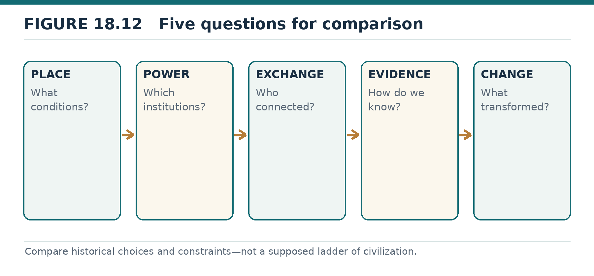

Какво научихме? Първо, Африка е допринесла за множество основни традиции на държавното формиране: Нилските кралства, планинските поляти, софийските империи, градските крайбрежни общности и царствата на Западна и Централна Африка. Второ, просперитетът често зависел от междурегионалния обмен, но ресурсите и институциите зад търговията били местни. Трето, археологически обекти, устни традиции, надписи и външни хроники изискват критична интерпретация. Четвърто, политическата промяна не се равнява на културно измиране.

Следващите глави ще се върнат към моделите, въведени в тази глава. Възходът и разпространението на исляма промениха търговските и интелектуални връзки в Северна и Западна Африка, както и на изток. Разширяването на Атлантическия океан и търговията с роби по - късно пренастроили политическите икономики и причинили дълбока вреда на милиони хора. Колониалното завоевание и антиколониалните движения трансформираха границите и щатите. Нито едно от тези събития няма смисъл, ако по-ранната история на Африка се разглежда като празна страница. Африкански актьори никога не са били просто фонови фигури в историите на други хора.

Най-полезното изречение за пренасяне напред е просто: няма единна африканска историческа траектория. Континентските общества са разнообразни, исторически свързани, иновативни, неподвижни, адаптивни и постоянно променящи се като общества другаде. Техните различия, а не една измислена еднообразие, ги превръщат в център на сериозна история на света.

<figure class="figure" id="figure-18-12">

<figcaption>Фигура 18.12. Сравнете историческите избори и не предполагаемата стълба на цивилизацията. <a class="figure-anchor" href="#figure-18-12" aria-label="Link to this figure">#</a></figcaption>
</figure>
